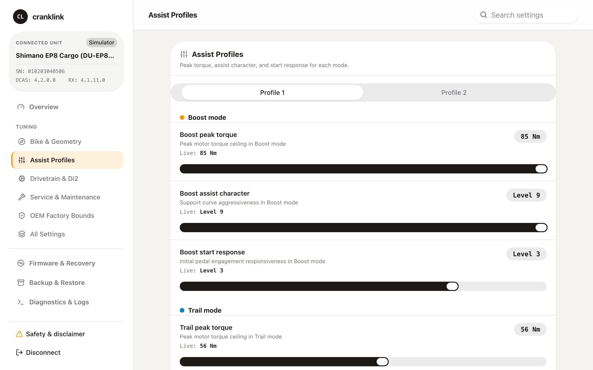

# cranklink

[](https://github.com/plainoss/cranklink/actions/workflows/build-cli.yml)
[](https://github.com/plainoss/cranklink/actions/workflows/web.yml)
[](LICENSE)

Diagnostics, settings, and bootloader recovery for Shimano STEPS drive units over the E-TUBE bus, via an SM-PCE02 adapter or a Bluetooth LE gateway. The web app and CLI also support model-specific settings for catalogued Di2 components, using the same Rust core.

> [!WARNING]
> Unofficial, experimental, and not affiliated with or endorsed by Shimano. Writing settings or firmware can permanently damage drive units, displays, or batteries and voids warranties. Raising the assist speed limit can make the bike non-compliant with local e-bike law. Use at your own risk.
>
> Firmware flashing has only been tested on a DU-EP800-CRG (identity `23/00`, board 1; see [terms](#terms)). cranklink checks the image's declared series, unit, and board, and the checksum of encrypted `.dat` containers, but cannot prove an image is correct for a given unit. Plaintext images, such as the EP800 M file, carry no checksum; writing one requires `--expect-sha256` with the SHA-256 of the file you verified. A wrong image can leave the motor unrecoverable, including by dealer tools.

The project began as the recovery of a bricked EP800-CRG that official tools and dealer service could not restore.

## Web app

**[cranklink.plainoss.workers.dev](https://cranklink.plainoss.workers.dev/)**

[](https://cranklink.plainoss.workers.dev/)

The core compiled to WebAssembly; all protocol work runs in the browser. Requires Chrome or Edge on desktop or Android (Safari and iOS lack WebUSB and Web Bluetooth), plus one of:

- **SM-PCE02** over WebUSB or Web Serial. On Android, use WebUSB. Firmware recovery also needs an SM-PCE02, but runs only in the [CLI](#recover-a-motor-stuck-in-bootloader-mode): the web app cannot reach a motor stuck in its bootloader.
- **Bluetooth**, via the bike's E-TUBE gateway (e.g. SC-EM800 or EW-WU111). Activate its connection mode before connecting and close other apps connected to the bike. The app includes model-specific pairing help: Di2 uses the appropriate function/Junction A button, while most STEPS displays open a short window after power-on or a button press. See [Bluetooth connection instructions](docs/bluetooth.md#connection-mode).

When finished, use **Disconnect** in the web app's top bar so the bike can return to riding mode. The app shows disconnect progress, then keeps Bluetooth closure and the bike's return to normal operation distinct: wait for its display, buttons and shifting to respond normally before leaving the completion screen.

If connecting fails, choose **View details & logs** on the connection screen. Diagnostics remains available without a connection. **Copy diagnostic report** includes the full failure and cleanup details, command history, routing choice, browser and deployed build revision; if clipboard access fails, select and copy the report text. Logs remain in the current tab until reload.

After connecting, use **Active component** to choose a drive unit, lever, derailleur, power unit, hub actuator, or cycle computer. The app loads that component's schema, displays read-only fields, and saves model- and serial-bound backups before writes. Save or discard staged edits before changing components.

Firmware images are not bundled.

Bluetooth detects supported STEPS and shifting-only master families before entering service mode, using the original connection. An unknown valid identity asks for a choice; **Bluetooth options** contains a manual override. This detection flow is awaiting phone/hardware validation; see the [validation sequence](docs/bluetooth.md#validate-automatic-detection-on-a-phone).

## Android app

The [Android app](android-app/README.md) provides a native Kotlin interface with a Kotlin Multiplatform session layer and the same Rust tuning engine as the web app. It connects to **Shimano STEPS e-bikes over Bluetooth LE only**, with staged edits, verified saves, and local backup import/export. Di2 component configuration and firmware flashing are outside the Android app's scope.

Requires Android 8.0 or later. Releases are published on Google Play as `app.plainoss.cranklink` (see [Android releases](docs/android-releases.md)). You can also build the APK from [android-app/](android-app/README.md#build), or use the debug APK artifact from the [Android workflow](https://github.com/plainoss/cranklink/actions/workflows/android.yml). Demo mode uses sample settings and requires no bike. System Back confirms disconnect and waits for active writes. The Android BLE path has automated protocol and session tests and has been tested on a physical bike.

## Hardware & Firmware Compatibility Matrix

| Drive Unit | Firmware | Display / Gateway | Transport | Assist Profiles (Tuning) | Region & Wheel Size | Firmware Recovery | Status & Guidance |
| :--- | :--- | :--- | :--- | :---: | :---: | :---: | :--- |
| **DU-EP800-CRG** | 4.1.10 – 4.2.0 | **SC-EM800** | **Wireless (BLE)** | ✅ Tested on Bike | ✅ Tested on Bike | — | Confirmed on physical hardware. Full wireless tuning supported. |
| **DU-EP800-CRG** | 4.1.10 – 4.2.0 | Any / None | **Wired (USB)** | ✅ Tested on Bike | ✅ Tested on Bike | Yes | Confirmed on physical hardware. Full wired tuning & bootloader recovery. |
| **DU-EP800** | 4.1.10 – 4.2.0 | Any | **Wireless / USB** | 🧪 In Testing (Preview) | 🧪 In Testing (Preview) | Yes² | Supported wired & wireless; shares EP800-CRG identity (`23/00`). |
| **DU-EP600 / EP600-CRG / EP801 / EP801-CRG / EP500** | 4.4.1 – 4.6.0 | **SC-EM800 / SC-EN600** | **Wireless / USB** | 🧪 In Testing (Preview) | 🧪 In Testing (Preview) | Opt-in¹ | Modern generation motors. Protocol verified; community bike testing in progress. |
| **DU-E5100** | All | Any | **Wireless / USB** | — | 🧪 In Testing (Preview) | Opt-in¹ | Region, speed limit (adjustable within 15–25 / 19–32 km/h), and maintenance settings supported. |
| **DU-E8000 / E8080** | 4.1.0 – 4.6.0 | **SC-E8000** | **Wireless (BLE)** | 🧪 In Testing (Preview) | 🧪 In Testing (Preview) | Opt-in¹ | Reading confirmed on bike. Direct wireless saving is in preview testing with automatic normal routing. Assist mode presets & Boost/Trail tuning supported. |
| **DU-E8000 / E8080** | 4.1.0 – 4.6.0 | Any / None | **Wired (USB)** | 🧪 In Testing (Preview) | 🧪 In Testing (Preview) | Opt-in¹ | Full wired support; no security code needed on D4.6. Assist mode presets & Boost/Trail tuning supported. |
| **DU-E8000 / E8080** | ≥ 4.7.0 – 4.10.0 | **SC-E8000** | **Wireless / USB** | 🧪 In Testing (Preview) | 🧪 In Testing (Preview) | Opt-in¹ | Handshake protocol verified. Wireless bike testing in progress. Assist mode presets & Boost/Trail tuning supported. |
| **DU-E6002 / E6012** | ≥ 3.3.0 | Any (E6010 / E6100) | **Wireless / USB** | — | 🧪 In Testing (Preview) | Opt-in¹ | Region (EU/US/Korea) available on firmware 3.3.0 and newer. |
| **DU-E7000** | All | **SC-E7000** | **Wireless / USB** | 🧪 In Testing (Preview) | 🧪 In Testing (Preview)* | Opt-in¹ | Assist mode presets, Boost/Trail tuning, wheel size, and mounting angle supported (*fixed factory region). |
| **DU-E6100 / E6110 / E6180** | All | **SC-E6100** | **Wireless / USB** | 🧪 In Testing (Preview) | 🧪 In Testing (Preview)* | Opt-in¹ | Assist pattern (Comfort/Sportive), wheel size, and mounting angle supported (*fixed factory region). |
| **DU-E6000 / E6001 / E6010 / E6050** | All (3.2 – 3.9) | Any (SC-E6000) | **Wireless / USB** | — | 🧪 In Testing (Preview)* | Opt-in¹ | Wheel size (2000–2400 mm) and mounting angle adjustment supported (*fixed factory region). |
| **DU-E5000 / E5080** | All | Any | **Wireless / USB** | — | — | — | Identification only; no settings supported. |

**Status Key**:
- **✅ Tested on Bike**: Confirmed and validated working on physical hardware.
- **🧪 In Testing (Preview)**: Implemented and protocol-checked in software; physical bike confirmation in progress.
- **—**: Setting is not applicable or not supported on this motor family.

All families support component discovery and identification. Other catalogued drive units, including the E5000 and E5080, are identified by `units` only: cranklink has no settings for them and cannot flash them from their application. A `--recovery` write with `--allow-unverified-model` still erases and writes them but cannot be verified afterwards; see the [patcher guide](docs/ep800-speed-limit-patcher.md#supported-images). Field availability depends on firmware and device permissions; see [settings](docs/settings.md).

DU-E8000/E8080 exposes **Region & assist speed** from D4.1.0: Europe (nominal 25 km/h) or United States (32 km/h). D4.1.0 and newer E8000 firmware also exposes assist mode presets (Dynamic, Explorer, Custom) and Boost/Trail levels; DU-E7000 supports the same presets and assist levels, and DU-E6100 supports assist pattern selection (Comfort vs Sportive). On bikes with SC-E8000 displays, Cranklink automatically selects normal Bluetooth routing to avoid legacy bus master arbitration issues, allowing region, assist tuning, and wheel circumference writes with verified readback and backups. See [legacy assist tuning](docs/settings.md#legacy-assist-tuning-e8000-e7000-e6100).

The CLI's automatic route selection is a conservative policy. An explicit `--ble-master=normal` uses normal routing with the usual session and authentication checks; hardware support for those writes still needs validation.

Connection setup and master-session teardown confirm the resulting slave mode even when an older gateway omits the immediate transition acknowledgement. Stock SC-E8000, SC-EM800, SC-E6100 and SC-E7000 firmware probes reproduce this behavior. The fix applies to every gateway through the shared connection code; full master connection on the reported E8000 bike remains unresolved, including a native test that established normal service before requesting master routing. See [hardware observations](docs/bluetooth.md#sc-e8000-406-native-hardware-observation).


The web app and CLI support classic and 11-speed Di2 lever/switch assignments (including top buttons and D-Fly channels on R9150/R8050/RX815), STEPS switch assignments and assist/shift mode swapping on SW-E7000/E6000/E6010-L/E8000-L, 10-, 11- and 12-speed front/rear derailleur multi-shift speed and synchronized shift settings, radio mode and passkey on 12-speed rear derailleurs (R9250/R8150/R7150/RX825 and RX827/RX717/RX828-SGS), passkey on EW-WU101/EW-WU111/EW-EN100 and wireless SC-E displays, SC-E8000/E6100/E7000/EM800/EN600/EN610 display settings and clock, MU-S705/MU-UR500/UR510/UR520 hub adjustment, and BT-DN110/BT-DN300 multi-shift limits. Wired and wireless 12-speed levers and SW-EN600/EM800 switches use other layouts and have no settings yet. Component coverage is selected from the live catalog identity; inspect `settings schema --model <COMPONENT>` for available fields. Catalogued components without an implemented layout show no available settings. These component layouts have protocol tests but have not been validated on hardware.

Exact MU-UR500 and cycle-computer firmware execution, CLI and browser save/restore checks, and partial BT-DN110/WU111 PC-link handler execution are described in the [firmware simulator documentation](docs/firmware-simulator.md). For an in-depth reference on EP800 D4.2.0 memory layout, flash journal compaction, packet queues, and protocol state machines, see the [EP800 D4.2.0 Firmware Architecture Reference](docs/firmware-d420-architecture.md). E6002 D3.3.0/D3.4.0 additionally execute region SET and fresh-CPU storage reload under an explicit resident ROM model; this does not validate protected sessions or physical hardware. Ordinary BLE disconnect behavior and its hardware validation are described in [Bluetooth recovery](docs/bluetooth.md#disconnect-and-di2-recovery).

¹ CLI only, with `--allow-unverified-model`. Not run on hardware. D (DCAS) writes have protocol tests; the RX (M) writer is documented for the EP800 family only and is untested for others.

² Shares the tested EP800-CRG's identity (`23/00`) and firmware family, so the CLI admits it without `--allow-unverified-model`; not run on hardware.

For how Cranklink discovers Di2 and e-bike components, interprets traffic and chooses component-specific operations, see [Understanding E-TUBE with Cranklink](docs/etube-protocol.md), including its [wire reference](docs/etube-protocol.md#wire-reference).

## Command line

### Install

The [rolling prerelease](https://github.com/plainoss/cranklink/releases/tag/rolling) provides the latest development binaries from `main` for Linux, macOS (Apple Silicon and Intel), and Windows, with BLE support and `.sha256` checksums. Every push to `main` rebuilds all four platforms; after tests, builds, and checksum verification pass, the workflow moves the `rolling` tag to the built commit and replaces the release assets. Older runs skip publishing if `main` has advanced. These binaries may contain unreleased changes.

Pushing a `v*` tag publishes a separate versioned [release](https://github.com/plainoss/cranklink/releases). To refresh the rolling release manually, run **Build & Release CLI** with **Run workflow** on `main`. Pull requests and merge queue runs validate builds without publishing.

The web validation and CLI release-preparation tests select the latest Node.js 22.x release, with 22.23.4 as the minimum to include the [Broccoli2Shell fix (CVE-2026-111497)](https://nodejs.org/en/blog/vulnerability/october-2026-security-releases). This selection controls workflow shell commands; JavaScript actions use the GitHub runner's separate embedded runtime.

To build from source (Rust 1.90+):

```sh
git clone https://github.com/plainoss/cranklink.git
cd cranklink
cargo build --release --locked --bin cranklink
./target/release/cranklink --help
```

Bluetooth support is a default feature; add `--no-default-features` for a USB-only build. Linux BLE needs a C compiler and BlueZ/D-Bus; macOS needs Bluetooth permission for the terminal.

Native connections stop scanning as soon as the requested peripheral appears;
explicit `ble scan` commands retain their full scan duration. See [Bluetooth](docs/bluetooth.md).

The prebuilt binaries are all built on Linux, and CI runs only the Linux one. The macOS binaries are not notarized: if macOS blocks the extracted binary, run `xattr -d com.apple.quarantine ./cranklink`.

**Connecting the adapter**

- **macOS**: `--port usb` for direct SM-PCE02 access.
- **Linux**: `--port usb` needs access to USB device `1e44:7151`, for example with a udev rule in `/etc/udev/rules.d/70-sm-pce02.rules`:

  ```text
  SUBSYSTEM=="usb", ATTR{idVendor}=="1e44", ATTR{idProduct}=="7151", MODE="0660", TAG+="uaccess"
  ```

  Then run `sudo udevadm control --reload && sudo udevadm trigger`, or replug the adapter. `uaccess` grants access only to the user at the local seat; on a headless or SSH-only host, use `GROUP="plugdev"` (or another group you are in) instead. A serial path such as `/dev/ttyUSB0` exists only if a USB-serial driver is bound to the adapter; cranklink does not detach that driver, so `--port usb` cannot claim the adapter while it is bound.
- **Windows**: prefer the FTDI COM port (`--port COM3`); direct USB (`--port usb`) requires WinUSB.
- Bridge recovery (`--bridge-recovery`) and `firmware dump-bootloader` work only over direct USB (`--port usb`), not a serial or COM port.
- Close other adapter applications first. If the adapter's supercapacitor needs charging, cranklink waits up to 90 s; keep USB connected.

### Connect and identify

```sh
cranklink scan                 # attached USB adapters (add --ble for Bluetooth gateways)
cranklink --port usb units     # components on the E-TUBE bus
cranklink --port usb units --stock-only  # stock identities/candidates; skip optional part queries
cranklink --port usb probe     # drive unit model, serial, firmware versions
cranklink --port 'ble:DEVICE_ID' --read-only ble detect-system # master family, before service mode
```

```text
Drive Unit Probe:
  Model:       DU-EP800-CRG (Slot 13)
  Serial:      010203040506
  Cargo ID:    00-CRG
  DCAS (D):    v4.2.0.0
  Renesas (M): v4.1.11.0
```

Settings writes (`set` and batches that set) and ordinary firmware flashing require `-s <SERIAL>` (the 12-digit hex serial from `probe`) and fail if the connected unit reports a different serial, checked again before each settings SET; restores are bound to the serial in their backup. Bridge recovery can read and bind the serial automatically after connecting. Record the serial before flashing: a motor stuck in its DCAS bootloader cannot run `probe`, but reports it as `Serial:` in recovery step 2, and a serial mismatch names the live serial.

### Read and change settings

```sh
# Snapshot all settings
cranklink --port usb -s <SERIAL> settings read --output settings.json

# Run the write's checks without writing
cranklink --port usb -s <SERIAL> settings set profile1.boost.torque 85 --dry-run

# Write it (saves a pre-write backup, then verifies by readback)
cranklink --port usb -s <SERIAL> settings set profile1.boost.torque 85 --backup before.json

# Roll back
cranklink --port usb -s <SERIAL> settings restore before.json

# Inspect and target a catalogued Di2 component
cranklink settings schema --model ST-6870-L
cranklink --port usb -c ST-6870-L -s <SERIAL> settings read
cranklink --port usb -c ST-6870-L -s <SERIAL> settings set switch-a-function 2 --backup lever-before.json
```

See [settings](docs/settings.md) for protected fields, backups, and batch plans, and [Bluetooth](docs/bluetooth.md) for wireless use.

Normal/slave BLE sessions close GATT directly so gateway firmware handles disconnect; explicit stop/reset commands left both tested bikes outside normal operation. The web app retains this service session between commands and distinguishes **Di2 shifting only (no STEPS motor)** from a **STEPS e-bike**, which can also use Di2 components. See the [Di2 BLE investigation](docs/di2-ble-investigation.md) for physical validation and remaining limits.

### Recover a motor stuck in bootloader mode

Requires an intact bootloader, stable power, and your own firmware containers (`.dat`, not bundled). Only a DU-EP800-CRG (`23/00`, DCASX board 1) has been tested; a plain DU-EP800 reports the same identity and is admitted too. Other families need `--allow-unverified-model`, for dry runs too. Recovery cannot fix hardware damage or an erased bootloader. RX (M) recovery also needs a responding D application.

```sh
# 1. Inspect the containers offline (it prints each file's integrity and SHA-256,
#    the companion's last); compare the printed Source SHA-256 (<D_SHA256> below)
#    with your trusted record of the D file
cranklink firmware inspect DUEP800-D.4.2.0.dat --companion DUEP800-M.4.1.11.dat

# 2. Confirm the bootloader responds and note its Serial (use it as <SERIAL> below)
cranklink --port usb firmware probe --target dcas --recovery

# 3. Dry run (default): validates target and container integrity, writes nothing
cranklink --port usb -s <SERIAL> firmware flash dcas DUEP800-D.4.2.0.dat \
  --companion DUEP800-M.4.1.11.dat --expect-sha256 <D_SHA256> --recovery

# 4. Write
cranklink --port usb -s <SERIAL> firmware flash dcas DUEP800-D.4.2.0.dat \
  --companion DUEP800-M.4.1.11.dat --expect-sha256 <D_SHA256> \
  --journal D.journal.jsonl --recovery --write
```

Ordinary recovery compares the file's SHA-256 only when `--expect-sha256` is given (writing a plaintext image requires it) and checks the companion's kind, series and version but not its hash; `--bridge-recovery` pins the stock D 4.2.0.0 and M 4.1.11.0 hashes itself.

For RX, probe with `--target rx`, then run `firmware flash rx` with the M file as input and the D file as companion. M files such as `DUEP800-M.4.1.11.dat` are plaintext, so `--write` also needs `--expect-sha256 <SHA-256>` of the M file you verified (`firmware inspect` prints it and the integrity status, as `Companion SHA-256` and `Companion Integrity` when M is the companion; `--json` has them as `source_sha256` and `integrity`, `md5-verified-container` or `none`, with the companion's under `companion`).

#### If a recovery step fails

Nothing is erased unless a write has started. Each case below says what cranklink prints and what to do.

- **A write fails after it started:** cranklink prints `CRITICAL: FLASH WRITE INTERRUPTED` with the journal path and the exact recovery command. Do not power-cycle the motor. Bluetooth cannot recover a motor, so after a failed `firmware flash ble-pair` write the printed command is one to run over a wired SM-PCE02.
- **The motor does not enter its bootloader, or does not acknowledge the reset after a refused image:** nothing was erased, but the motor may stay in its DCAS bootloader at the application's slot. A flash journals `boot-entry-failed` for a failed entry. Both cases print a read-only `cranklink probe` to check whether the application still answers and, only if it does not, the `firmware probe --target dcas --recovery --reset` command, with that `--slot`, that returns it to its application. A journal write that fails after entry is reported with the refusal and never skips the reset.
- **An RX (M) probe or dry run:** `firmware probe --target rx` and an RX dry run reset the boot bridge and restart the application after they read the RX bootloader, also when they refuse its reply; a journal write that fails first never skips the reset. If RX update entry fails before a usable reply, RX may stay in update mode with the bridge active, and no reset is sent; a dry run journals `rx-boot-failed`, and a failed bridge reset `rx-reset-failed`. Nothing was erased in either case. Check the application with the read-only `cranklink probe` before retrying, or with `firmware probe --target rx --recovery` after a `--recovery` run, since a recovery RX application cannot report its version.
- **A DCAS dry run or probe without `--recovery`:** these reset the bootloader and succeed only after the application comes back with the same cargo and D/M versions. If it does not come back, the dry run journals `application-return-failed`, and both print the same check-then-reset guidance.
- **The motor is slow to answer after a reset:** after any bootloader reset (a DCAS probe or dry run, the RX probe and dry run, the return after a completed DCAS or RX write, and `firmware probe --target dcas --recovery --reset`), the motor can take a few seconds to answer discovery again. Cranklink repeats discovery up to four times, about 24 s, until the motor answers, and journals the number of discoveries it took as `discoveries`. If no component answers, the error says so. Ordinary probes discover once. `--recovery --reset` succeeds only once a motor answers.
- **A write finished but the application does not answer:** if the transfer finished with its checksum and reset acknowledged but the application does not answer, the write journals `verification-failed` and prints the same read-only `cranklink probe` check, followed, for D, by the `--recovery --reset` command for the bootloader's slot.

#### Other recovery tools

For the EP800 failure that acknowledges Key 1 but floods empty `0x70` frames before Key 2, follow the [temporary bridge recovery guide](docs/ep800-hardware-recovery.md) using `firmware flash dcas --bridge-recovery`.

For bootloader research on a working, powered EP800-CRG, `firmware dump-bootloader --output NEW_DIR` reads the 64 KiB resident window without flashing. See the [extraction instructions](docs/ep800-hardware-recovery.md#read-a-working-motors-bootloader).

More options:

- `cranklink --help` and `cranklink <command> --help` list all commands and options.
- `--json` gives machine-readable output. With it, a wired DCAS or RX dry run and a `ble-pair` dry run print one JSON object (`"dry_run": true`, the verified target and serial, and `requires_*` flags, each true when the `--write` command must carry that option, such as `--expect-sha256` for a plaintext image) instead of the text report, and `firmware probe` prints its JSON only once its checks pass.
- Environment variables: `CRANKLINK_PORT`, `CRANKLINK_SERIAL` and `CRANKLINK_FORMAT` (`json` or `text`) stand in for `--port`, `-s` and `--format` when those are omitted; `CRANKLINK_PASSKEY` supplies the passkey for `ble:` ports.
- `cranklink --port usb session` serves a read-only JSON-RPC 2.0 driver on stdin and stdout for scripts and agents (wired ports only); see [JSON-RPC session](docs/session.md).

## Terms

- **Drive unit**: the e-bike motor.
- **Modern and legacy motors**: modern motors are the EP600, EP801 and EP500 (including their CRG variants). They use a newer authentication scheme and add the Japan and US Class 3 [market regions](docs/settings.md#market-regions). Legacy motors are the EP800 family, E5100 and older drive units.
- **Market region** (`destination` in the CLI and backups): the sales market the motor is set for, which limits its assist speed.
- **D and M firmware**: a STEPS motor has two processors. D runs on the Shimano communication chip (DCAS) and talks to the E-TUBE bus; M runs on the Renesas motor-control chip (also called RX). Firmware files come in matching D and M pairs.
- **Identity** (for example `23/00`): the series and unit numbers a component reports, used to pick the right settings and firmware checks. `23/00` is the EP800 and EP800-CRG.
- **Gateway**: the part of the bike with Bluetooth (a display such as the SC-EM800, or a wireless unit such as the EW-WU111) that apps connect through.
- **Slot**: a component's address on the E-TUBE wire. It can change after a power cycle.
- **OEM or protected field**: a factory limit that needs motor authentication to change.
- **Master routing**: a Bluetooth mode some motor writes need. Afterwards the bike may need to be switched off and on to return to riding mode.

## Documentation

- [Settings](docs/settings.md): protected writes, backups, batch plans.
- [Bluetooth](docs/bluetooth.md): CLI over a BLE gateway.
- [JSON-RPC session](docs/session.md): `cranklink session` methods, errors and framing for scripts.
- [Understanding E-TUBE](docs/etube-protocol.md): discovery, routing and the wire reference.
- [EP800 hardware recovery](docs/ep800-hardware-recovery.md): temporary bridge recovery and bootloader extraction.
- [Firmware simulator](docs/firmware-simulator.md): offline application tests, `sim.py resident` bootloader regressions, and hash-verified [Di2 firmware acquisition](docs/firmware-simulator.md#di2-research-inputs).
- [Firmware patcher](docs/ep800-speed-limit-patcher.md): create and check supported motor images offline with `tools/patch_motor_speed.py`.
- [Web app development](web-instrument/README.md): build, test, deploy.
- [Android app development](android-app/README.md): BLE tuning app, native libraries, APK builds, and tests.

## License

[MIT](LICENSE). Product names identify compatible hardware only. This project is independent of Shimano and is not endorsed by or affiliated with Shimano.
