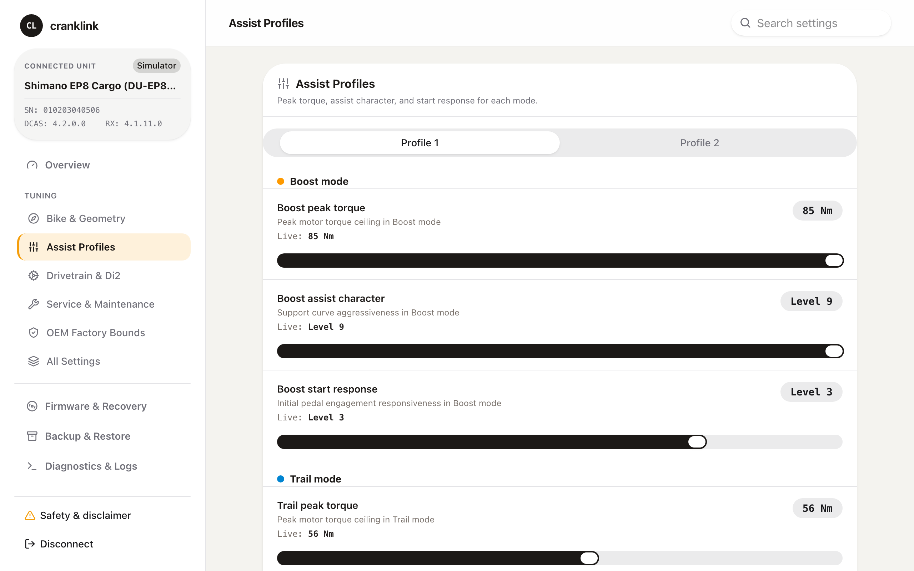

# cranklink

[](https://github.com/plainoss/cranklink/actions/workflows/build-cli.yml)
[](https://github.com/plainoss/cranklink/actions/workflows/web.yml)
[](LICENSE)

Diagnostics, settings, and bootloader recovery for Shimano STEPS drive units over the E-TUBE bus, via an SM-PCE02 adapter or a Bluetooth LE gateway. The web app and CLI also support model-specific settings for catalogued Di2 components, using the same Rust core.

> [!WARNING]
> Unofficial, experimental, and not affiliated with or endorsed by Shimano. Writing settings or firmware can permanently damage drive units, displays, or batteries and voids warranties. Raising the assist speed limit can make the bike non-compliant with local e-bike law. Use at your own risk.
>
> Firmware flashing has only been tested on a DU-EP800-CRG (`23/00`, DCASX board 1). cranklink checks the image's declared series, unit, and board, and the checksum of encrypted `.dat` containers, but cannot prove an image is correct for a given unit. Plaintext images, such as the EP800 M file, carry no checksum; writing one requires `--expect-sha256` with the SHA-256 of the file you verified. A wrong image can leave the motor unrecoverable, including by dealer tools.

The project began as the recovery of a bricked EP800-CRG that official tools and dealer service could not restore.

## Web app

**[cranklink.plainoss.workers.dev](https://cranklink.plainoss.workers.dev/)**

[](https://cranklink.plainoss.workers.dev/)

The core compiled to WebAssembly; all protocol work runs in the browser. Requires Chrome or Edge on desktop or Android (Safari and iOS lack WebUSB and Web Bluetooth), plus one of:

- **SM-PCE02** over WebUSB or Web Serial. On Android, use WebUSB. Firmware recovery also needs an SM-PCE02, but runs only in the [CLI](#recover-a-motor-stuck-in-bootloader-mode): the web app cannot reach a motor stuck in its bootloader.
- **Bluetooth**, via the bike's E-TUBE gateway (e.g. SC-EM800 or EW-WU111). Activate its connection mode before connecting and close other apps connected to the bike. The app includes model-specific pairing help: Di2 uses the appropriate function/Junction A button, while most STEPS displays open a short window after power-on or a button press. See [Bluetooth connection instructions](docs/bluetooth.md#connection-mode).

When finished, use **Disconnect** in the web app's top bar so the bike can return to riding mode. The app shows disconnect progress, then keeps Bluetooth closure and the bike's return to normal operation distinct: wait for its display, buttons and shifting to respond normally before leaving the completion screen.

Bluetooth detects supported STEPS and shifting-only master families before entering service mode, using the original connection. An unknown valid identity asks for a choice; **Bluetooth options** contains a manual override. This detection flow is awaiting phone/hardware validation; see the [validation sequence](docs/bluetooth.md#validate-automatic-detection-on-a-phone).

After connecting, use **Active component** to choose a drive unit, lever, derailleur, power unit, hub actuator, or cycle computer. The app loads that component's schema, displays read-only fields, and saves model- and serial-bound backups before writes. Save or discard staged edits before changing components.

Firmware images are not bundled.

## Supported motors

| Drive unit | Settings | Firmware recovery | Hardware-tested |
| --- | --- | --- | --- |
| EP800-CRG | Profiles, speed, wheel, lamp | Yes | Yes |
| EP800 | Profiles, speed, wheel, lamp | Yes² | No |
| EP600, EP600-CRG, EP801, EP801-CRG, EP500 | Profiles, speed, wheel, lamp | Opt-in¹ | No |
| E5100 | Common settings, speed | Opt-in¹ | No |
| E8000, E7000, E6100, E6000, E6001 families | Wheel, mounting angle, lamp | Opt-in¹ | No |
| E6002, E6012 | Wheel, mounting angle, lamp; EU/US/Korea region from D3.3.0 | Opt-in¹ | No |

All families support component discovery and identification. Other catalogued drive units, including the E5000 and E5080, are identified by `units` only: cranklink has no settings for them and cannot flash them from their application. A `--recovery` write with `--allow-unverified-model` still erases and writes them but cannot be verified afterwards; see the [patcher guide](docs/ep800-speed-limit-patcher.md#supported-images). Field availability depends on firmware and device permissions; see [settings](docs/settings.md).

The web app and CLI support classic Di2 lever/switch assignments, front/rear derailleur settings, power-unit multi-shift limits, MU-S705/MU-UR500/UR510/UR520 hub settings, and selected cycle-computer settings. Component coverage is selected from the live catalog identity; inspect `settings schema --model <COMPONENT>` for available fields. Catalogued components without an implemented layout show no available settings. These component layouts have protocol tests but have not been validated on hardware.

Exact MU-UR500 and cycle-computer firmware execution, CLI and browser save/restore checks, and partial BT-DN110/WU111 PC-link handler execution are described in the [firmware simulator documentation](docs/firmware-simulator.md). For an in-depth reference on EP800 D4.2.0 memory layout, flash journal compaction, packet queues, and protocol state machines, see the [EP800 D4.2.0 Firmware Architecture Reference](docs/firmware-d420-architecture.md). E6002 D3.3.0/D3.4.0 additionally execute region SET and fresh-CPU storage reload under an explicit resident ROM model; this does not validate protected sessions or physical hardware. Ordinary BLE disconnect behavior and its hardware validation are described in [Bluetooth recovery](docs/bluetooth.md#disconnect-and-di2-recovery).

¹ CLI only, with `--allow-unverified-model`. Not run on hardware. D (DCAS) writes have protocol tests; the RX (M) writer is documented for the EP800 family only and is untested for others.

² Shares the tested EP800-CRG's identity (`23/00`) and firmware family, so the CLI admits it without `--allow-unverified-model`; not run on hardware.

For how Cranklink discovers Di2 and e-bike components, interprets traffic and chooses component-specific operations, see [Understanding E-TUBE with Cranklink](docs/etube-protocol.md), including its [wire reference](docs/etube-protocol.md#wire-reference).

## Command line

### Install

The [rolling prerelease](https://github.com/plainoss/cranklink/releases/tag/rolling) provides the latest development binaries from `main` for Linux, macOS (Apple Silicon and Intel), and Windows, with BLE support and `.sha256` checksums. Every push to `main` rebuilds all four platforms; after tests, builds, and checksum verification pass, the workflow moves the `rolling` tag to the built commit and replaces the release assets. Older runs skip publishing if `main` has advanced. These binaries may contain unreleased changes.

Pushing a `v*` tag publishes a separate versioned [release](https://github.com/plainoss/cranklink/releases). To refresh the rolling release manually, run **Build & Release CLI** with **Run workflow** on `main`. Pull requests and merge queue runs validate builds without publishing.

The web validation and CLI release-preparation tests select the latest Node.js 22.x release, with 22.23.4 as the minimum to include the [Broccoli2Shell fix (CVE-2026-111497)](https://nodejs.org/en/blog/vulnerability/october-2026-security-releases). This selection controls workflow shell commands; JavaScript actions use the GitHub runner's separate embedded runtime.

To build from source (Rust 1.90+):

```sh
git clone https://github.com/plainoss/cranklink.git
cd cranklink
cargo build --release --locked --bin cranklink
./target/release/cranklink --help
```

Bluetooth support is a default feature; add `--no-default-features` for a USB-only build. Linux BLE needs a C compiler and BlueZ/D-Bus; macOS needs Bluetooth permission for the terminal.

The prebuilt binaries are all built on Linux, and CI runs only the Linux one. The macOS binaries are not notarized: if macOS blocks the extracted binary, run `xattr -d com.apple.quarantine ./cranklink`.

**Connecting the adapter**

- **macOS**: `--port usb` for direct SM-PCE02 access.
- **Linux**: `--port usb` needs access to USB device `1e44:7151`, for example with a udev rule in `/etc/udev/rules.d/70-sm-pce02.rules`:

  ```text
  SUBSYSTEM=="usb", ATTR{idVendor}=="1e44", ATTR{idProduct}=="7151", MODE="0660", TAG+="uaccess"
  ```

  Then run `sudo udevadm control --reload && sudo udevadm trigger`, or replug the adapter. `uaccess` grants access only to the user at the local seat; on a headless or SSH-only host, use `GROUP="plugdev"` (or another group you are in) instead. A serial path such as `/dev/ttyUSB0` exists only if a USB-serial driver is bound to the adapter; cranklink does not detach that driver, so `--port usb` cannot claim the adapter while it is bound.
- **Windows**: prefer the FTDI COM port (`--port COM3`); direct USB (`--port usb`) requires WinUSB.
- Bridge recovery (`--bridge-recovery`) and `firmware dump-bootloader` work only over direct USB (`--port usb`), not a serial or COM port.
- Close other adapter applications first. If the adapter's supercapacitor needs charging, cranklink waits up to 90 s; keep USB connected.

### Connect and identify

```sh
cranklink scan                 # attached USB adapters (add --ble for Bluetooth gateways)
cranklink --port usb units     # components on the E-TUBE bus
cranklink --port usb units --stock-only  # stock identities/candidates; skip optional part queries
cranklink --port usb probe     # drive unit model, serial, firmware versions
cranklink --port 'ble:DEVICE_ID' --read-only ble detect-system # master family, before service mode
```

```text
Drive Unit Probe:
  Model:       DU-EP800-CRG (Slot 13)
  Serial:      010203040506
  Cargo ID:    00-CRG
  DCAS (D):    v4.2.0.0
  Renesas (M): v4.1.11.0
```

Settings writes (`set` and batches that set) and ordinary firmware flashing require `-s <SERIAL>` (the 12-digit hex serial from `probe`) and fail if the connected unit reports a different serial, checked again before each settings SET; restores are bound to the serial in their backup. Bridge recovery can read and bind the serial automatically after connecting. Record the serial before flashing: a motor stuck in its DCAS bootloader cannot run `probe`, but reports it as `Serial:` in recovery step 2, and a serial mismatch names the live serial.

### Read and change settings

```sh
# Snapshot all settings
cranklink --port usb -s <SERIAL> settings read --output settings.json

# Run the write's checks without writing
cranklink --port usb -s <SERIAL> settings set profile1.boost.torque 85 --dry-run

# Write it (saves a pre-write backup, then verifies by readback)
cranklink --port usb -s <SERIAL> settings set profile1.boost.torque 85 --backup before.json

# Roll back
cranklink --port usb -s <SERIAL> settings restore before.json

# Inspect and target a catalogued Di2 component
cranklink settings schema --model ST-6870-L
cranklink --port usb -c ST-6870-L -s <SERIAL> settings read
cranklink --port usb -c ST-6870-L -s <SERIAL> settings set switch-a-function 2 --backup lever-before.json
```

See [settings](docs/settings.md) for protected fields, backups, and batch plans, and [Bluetooth](docs/bluetooth.md) for wireless use.

Normal/slave BLE sessions close GATT directly so gateway firmware handles disconnect; explicit stop/reset commands left both tested bikes outside normal operation. The web app retains this service session between commands and distinguishes **Di2 shifting only (no STEPS motor)** from a **STEPS e-bike**, which can also use Di2 components. See the [Di2 BLE investigation](docs/di2-ble-investigation.md) for physical validation and remaining limits.

### Recover a motor stuck in bootloader mode

Requires an intact bootloader, stable power, and your own firmware containers (`.dat`, not bundled). Only a DU-EP800-CRG (`23/00`, DCASX board 1) has been tested; a plain DU-EP800 reports the same identity and is admitted too. Other families need `--allow-unverified-model`, for dry runs too. Recovery cannot fix hardware damage or an erased bootloader. RX (M) recovery also needs a responding D application.

```sh
# 1. Inspect the containers offline (it prints each file's integrity and SHA-256,
#    the companion's last); compare the printed Source SHA-256 (<D_SHA256> below)
#    with your trusted record of the D file
cranklink firmware inspect DUEP800-D.4.2.0.dat --companion DUEP800-M.4.1.11.dat

# 2. Confirm the bootloader responds and note its Serial (use it as <SERIAL> below)
cranklink --port usb firmware probe --target dcas --recovery

# 3. Dry run (default): validates target and container integrity, writes nothing
cranklink --port usb -s <SERIAL> firmware flash dcas DUEP800-D.4.2.0.dat \
  --companion DUEP800-M.4.1.11.dat --expect-sha256 <D_SHA256> --recovery

# 4. Write
cranklink --port usb -s <SERIAL> firmware flash dcas DUEP800-D.4.2.0.dat \
  --companion DUEP800-M.4.1.11.dat --expect-sha256 <D_SHA256> \
  --journal D.journal.jsonl --recovery --write
```

Ordinary recovery compares the file's SHA-256 only when `--expect-sha256` is given (writing a plaintext image requires it) and checks the companion's kind, series and version but not its hash; `--bridge-recovery` pins the stock D 4.2.0.0 and M 4.1.11.0 hashes itself.

For RX, probe with `--target rx`, then run `firmware flash rx` with the M file as input and the D file as companion. M files such as `DUEP800-M.4.1.11.dat` are plaintext, so `--write` also needs `--expect-sha256 <SHA-256>` of the M file you verified (`firmware inspect` prints it and the integrity status, as `Companion SHA-256` and `Companion Integrity` when M is the companion; `--json` has them as `source_sha256` and `integrity`, `md5-verified-container` or `none`, with the companion's under `companion`).

A write that fails after it starts prints `CRITICAL: FLASH WRITE INTERRUPTED` with the journal path and the exact recovery command; do not power-cycle the motor. Bluetooth cannot recover a motor, so after a failed `firmware flash ble-pair` write the command is one to run over a wired SM-PCE02.

If a flash or probe fails while entering the bootloader from the application, or the bootloader reset after a refused image is not acknowledged, nothing was erased, but the motor may stay in its DCAS bootloader at the application's slot. A flash journals `boot-entry-failed` for a failed entry; both print a read-only `cranklink probe` to check whether the application still answers and, only if it does not, the `firmware probe --target dcas --recovery --reset` command, with that `--slot`, that returns it to its application. A journal write that fails after entry is reported with the refusal and never skips the reset.

`firmware probe --target rx` and an RX dry run reset the boot bridge and restart the application after they read the RX bootloader, also when they refuse its reply; a journal write that fails first never skips the reset. If RX update entry fails before a usable reply, RX may stay in update mode with the bridge active, and no reset is sent; a dry run journals `rx-boot-failed`, and a failed bridge reset `rx-reset-failed`. Nothing was erased in either case, and both commands say to check the application with the read-only `cranklink probe` before retrying, or with `firmware probe --target rx --recovery` after a `--recovery` run, since a recovery RX application cannot report its version.

Without `--recovery`, a DCAS dry run and `firmware probe --target dcas` reset the bootloader and succeed only after the application comes back with the same cargo and D/M versions. If it does not come back, the dry run journals `application-return-failed`, and both print the same check-then-reset guidance.

After any bootloader reset (a DCAS probe or dry run, the RX probe and dry run, the return after a completed DCAS or RX write, and `firmware probe --target dcas --recovery --reset`), the motor can take a few seconds to answer discovery again. Cranklink repeats discovery up to four times, about 24 s, until the motor answers, and journals the number of discoveries it took as `discoveries`. If no component answers, the error says so. Ordinary probes discover once. `--recovery --reset` now succeeds only once a motor answers. If a write's transfer finished with its checksum and reset acknowledged but the application does not answer, the write journals `verification-failed` and prints the same read-only `cranklink probe` check, followed, for D, by the `--recovery --reset` command for the bootloader's slot.

For the EP800 failure that acknowledges Key 1 but floods empty `0x70` frames before Key 2, follow the [temporary bridge recovery guide](docs/ep800-hardware-recovery.md) using `firmware flash dcas --bridge-recovery`.

For bootloader research on a working, powered EP800-CRG, `firmware dump-bootloader --output NEW_DIR` reads the 64 KiB resident window without flashing. See the [extraction instructions](docs/ep800-hardware-recovery.md#read-a-working-motors-bootloader).

`cranklink --help` and `cranklink <command> --help` list all commands and options. `--json` gives machine-readable output. With it, a wired DCAS or RX dry run and a `ble-pair` dry run print one JSON object (`"dry_run": true`, the verified target and serial, and `requires_*` flags, each true when the `--write` command must carry that option, such as `--expect-sha256` for a plaintext image) instead of the text report, and `firmware probe` prints its JSON only once its checks pass. `CRANKLINK_PORT`, `CRANKLINK_SERIAL` and `CRANKLINK_FORMAT` (`json` or `text`) stand in for `--port`, `-s` and `--format` when those are omitted; `CRANKLINK_PASSKEY` supplies the passkey for `ble:` ports. `cranklink --port usb session` serves a read-only JSON-RPC 2.0 driver on stdin and stdout for scripts and agents (wired ports only); see [JSON-RPC session](docs/session.md).

## Documentation

- [Settings](docs/settings.md): protected writes, backups, batch plans.
- [Bluetooth](docs/bluetooth.md): CLI over a BLE gateway.
- [JSON-RPC session](docs/session.md): `cranklink session` methods, errors and framing for scripts.
- [Understanding E-TUBE](docs/etube-protocol.md): discovery, routing and the wire reference.
- [EP800 hardware recovery](docs/ep800-hardware-recovery.md): temporary bridge recovery and bootloader extraction.
- [Firmware simulator](docs/firmware-simulator.md): offline application tests, `sim.py resident` bootloader regressions, and hash-verified [Di2 firmware acquisition](docs/firmware-simulator.md#di2-research-inputs).
- [Firmware patcher](docs/ep800-speed-limit-patcher.md): create and check supported motor images offline with `tools/patch_motor_speed.py`.
- [Web app development](web-instrument/README.md): build, test, deploy.

## License

[MIT](LICENSE). Product names identify compatible hardware only. This project is independent of Shimano and is not endorsed by or affiliated with Shimano.
