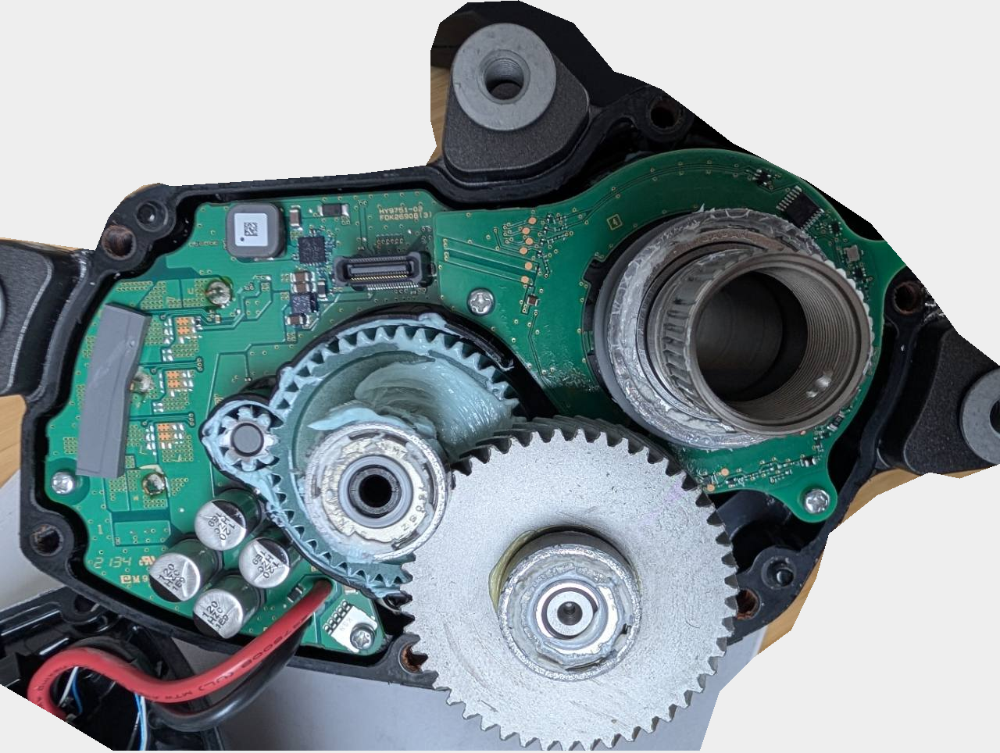
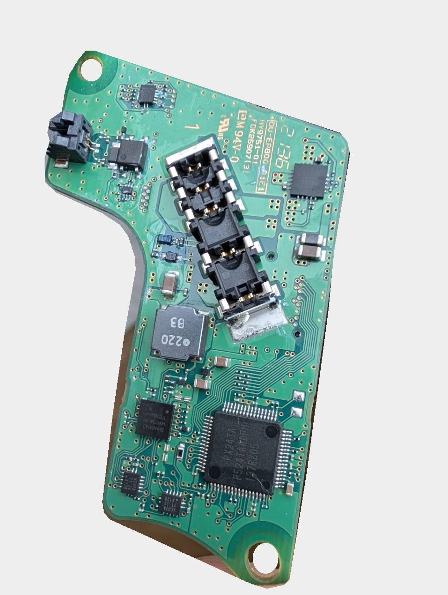
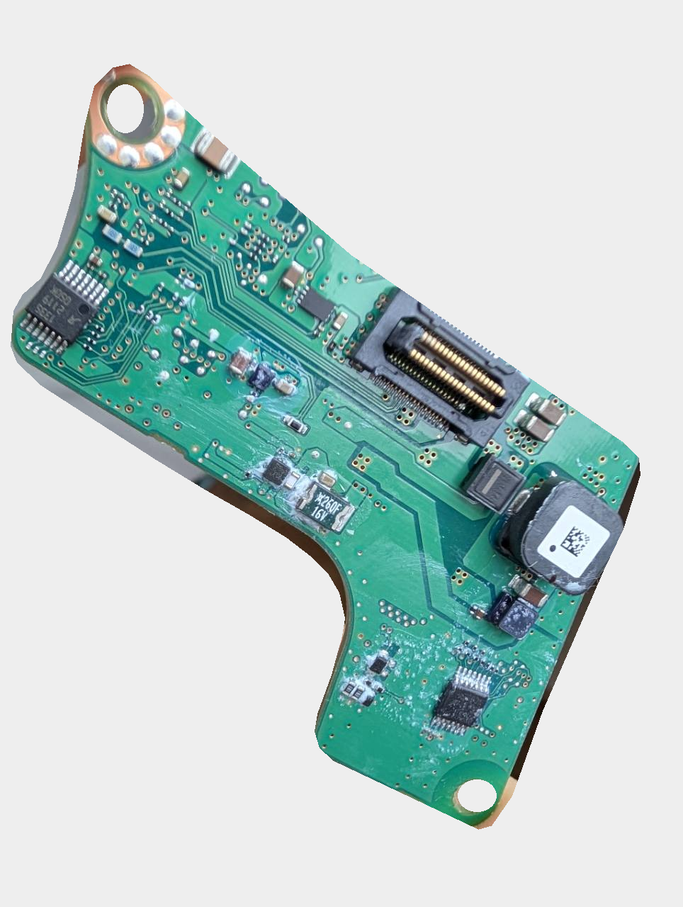
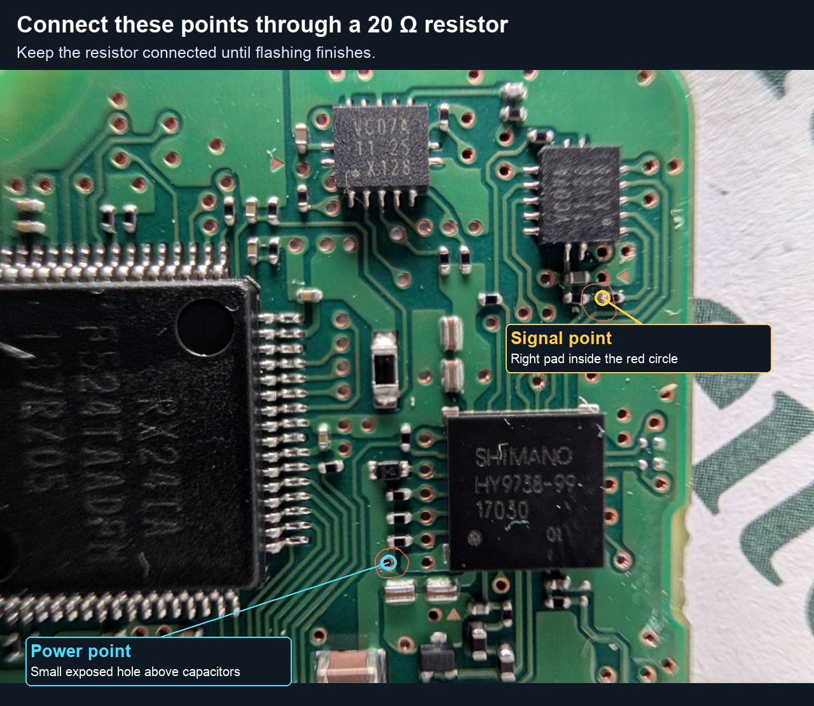
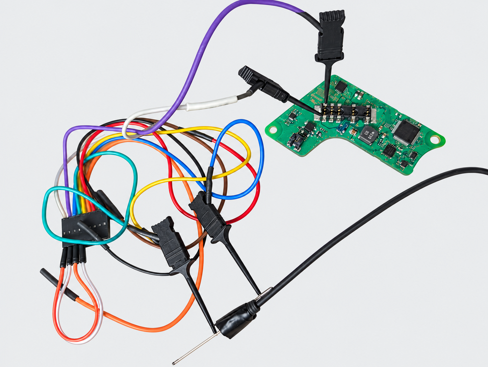

# Restore an EP800 through E-TUBE with a temporary resistor bridge

Use this procedure for a motor that answers the first firmware connection key
but stalls before the second, repeatedly sending empty `0x70` responses. The
bridge lets its bootloader—the motor's recovery program—accept the connection
and restore the original firmware through E-TUBE. **D** is the Shimano
communication processor; **M** is the Renesas motor-control processor. This
procedure restores D only, leaving M firmware and settings unchanged. Try the
[normal recovery CLI](../README.md#recover-a-motor-stuck-in-bootloader-mode) first.

This worked on one **DU-EP800-CRG, board 1, series `23`, unit `00`, bootloader
5.0.6.1**, using an **SM-PCE02 and macOS native USB**. The CLI mode below incorporates
that successful recovery sequence and has been tested offline; the integrated
build has not been rerun on hardware. Other boards and platforms remain untested.

## Why the bridge helps

The motor stopped booting after a modified firmware binary was flashed. An
unsupported ARM instruction was suspected, but the original fault was not
confirmed.

We read the bootloader from a working EP800-CRG with the same bootloader
version and ran that code in the firmware simulator. The tests
showed how repeated empty replies on SPI, the internal link between the two
processors, could keep the bootloader busy sending `0x70` responses instead of
processing the second E-TUBE connection key.

When the simulated SPI input returned `0xFF` (all bits high), the bootloader
stopped accepting those empty replies and could process the remaining keys.
This led us to try a resistor that pulls the corresponding board signal high.
Keeping it connected allowed a complete stock firmware restore on the failed
motor. That supports the simulator explanation; the failed motor's internal
SPI data was not directly measured.

You do not need a donor motor or a bootloader dump. Recovery restores the
original D application, leaving the resident bootloader in place.

## Find the connector board

Disconnect the battery and USB before opening or handling the motor.



The board around the gears is the power board. The recovery contacts are on the
separate connector board shown below.



The connector board holds the E-TUBE sockets, the large Renesas processor (M),
and the smaller square SHIMANO chip (D). This is the side needed for the bridge.



The large connector on the reverse side links the two boards.

## 1. Connect the marked points

With battery and USB disconnected, position the contacts on the connector
board. The adaptor supplies power for recovery; no battery is needed.



With the **SHIMANO lettering upright**:

| Point | Where to connect |
|---|---|
| **VCC 3.3 V** | The marked exposed via just left of the Shimano chip's lower-left corner, above the left of the two large ceramic capacitors. |
| **SPI MISO** | The marked right-hand solder pad of the lower small horizontal component beneath the upper-right small chip. |

SPI MISO runs from the Renesas MCU's pin 45 (P22/MISOA), through the VC07A
buffer (input pin 1 → output pin 2) and a 100 Ω resistor, to the Shimano chip.
The marked signal point is on the Shimano side of that resistor.

```text
VCC 3.3 V ── 20 ohm resistor ── SPI MISO
```

Use the resistor, not a direct wire. **20 ohms worked on this board; confirm your
board matches before using it.** Secure and insulate the connection so it can
stay in place for the entire transfer.

## 2. Connect E-TUBE



For the breakout used in this recovery:

| Viewing direction | E-TUBE inner conductor | E-TUBE outer conductor |
|---|---|---|
| Male plug viewed into its mating face, **flat part down** | Rightmost contact | Leftmost contact |
| Motor casing in the photographed orientation | Upper | Lower |
| Connector board with its identification lettering readable in the operator's orientation | Upper contact | Lower contact |

Looking from the cable side reverses left/right. Inner/outer describe the cable
conductors; this table does not assign positive/ground or wire colours. Preserve
the viewing orientation when comparing your wiring.

## 3. Prepare the CLI and original firmware

You need Rust and your own stock firmware files. Close other programs using the
adaptor. Save any existing settings backup.

Bridge recovery and the bootloader extraction below connect only through direct
USB (`--port usb`). On Linux this needs the udev rule from the
[adapter setup](../README.md#install); on Windows it needs the WinUSB driver
instead of the FTDI COM port.

This mode accepts only **D 4.2.0.0** with **M 4.1.11.0**. Confirm from your records
that M already has that version. The supplied M file is checked for compatibility
but is not flashed; its live version cannot be checked before restoring D. The
CLI checks the files' versions and hashes automatically.

From the repository root, build the CLI:

```sh
cargo build --locked --bin cranklink
```

Replace the paths below with your own. Run this preparation check
first; without `--write`, this mode does not connect to hardware:

```sh
./target/debug/cranklink --port usb firmware flash dcas \
  /path/to/DUEP800-D.4.2.0.dat \
  --companion /path/to/DUEP800-M.4.1.11.dat --bridge-recovery
```

No firmware files are included in this repository.

You do not need to know the motor's serial beforehand. Once the recovery
connection works, the CLI reads it from the motor's bootloader, displays it and
records it in the journal. If you know the 12-digit hexadecimal serial, add
`-s YOUR12HEXUID` before `firmware` to require a match. The CLI checks the
bootloader and board identity in either case.

## 4. Run the restore

With the wiring and resistor secured, connect USB. Run:

```sh
./target/debug/cranklink --port usb firmware flash dcas \
  /path/to/DUEP800-D.4.2.0.dat \
  --companion /path/to/DUEP800-M.4.1.11.dat --bridge-recovery --write
```

The countdown gives you ten seconds to establish contact. The CLI tries the
connection up to twenty times, then starts one stock restore when all five keys
are acknowledged and the motor's identity is checked. Use `--countdown` or
`--attempts` to change those defaults.

**Keep the resistor connected through erase, the entire transfer, finish and
reset.** Releasing it after the keys is too early. In the original recovery,
removing it during transfer caused the motor to stall again.

Wait for `Stock transfer finish/reset acknowledged` and a successful exit.

Only then remove the temporary resistor, leaving USB and E-TUBE connected.

## 5. Verify without the resistor

```sh
./target/debug/cranklink --port usb probe
./target/debug/cranklink --port usb -s YOUR12HEXUID settings read \
  --output settings-after.json
```

Use the serial printed during recovery for `YOUR12HEXUID`. Check that `probe`
reports the same serial and expected cargo identity, D **4.2.0.0**, and M **4.1.11.0**.
Compare the settings with your original backup.

The successful recovery verified normal communication and **74/74 original
settings** after removing the resistor. A full flash-byte readback and physical
motor operation were not tested. Check operation separately after reassembly.

## If the transfer is interrupted

Keep the journal and diagnostic files printed by the CLI; they contain device
identifiers, so review them before sharing. The CLI does **not** retry a restore
or resume a partial image after an uncertain write. Diagnose the failure before
deliberately starting another complete restore. The successful case needed a
fresh connection and full rewrite after an interrupted first attempt.

Connection-only retries do not erase firmware, but may reset or cycle adaptor
power.

Use `--bridge-recovery` for this procedure; ordinary `--recovery` uses a different
connection sequence.

## Read a working motor's bootloader

For further investigation, this read-only command extracts the 64 KiB resident
window from a working EP800-CRG. Keep the bike powered normally and connect the
SM-PCE02 through its E-TUBE wiring. It supports D 4.1.11.0 or 4.2.0.0,
M 4.1.11.0, and bootloader 5.0.6.1.

```sh
./target/debug/cranklink --port usb --read-only firmware dump-bootloader \
  --output donor-read-01
```

The new directory contains `resident.bin`, its SHA256 and identity receipt in
`result.json`, and a wire trace. The command makes one complete pass and keeps
partial output if a read fails. It does not flash firmware or change settings.
Add `-s YOUR12HEXUID` to select a motor if several are found.

This requires a responsive application; it cannot extract a dump from the
stalled bootloader. A donor dump is not needed for the restore above.

## For developers

[`src/recovery.rs`](../src/recovery.rs) selects adaptor protocol `0x60`, target
31 and legacy framing selector 5. After all five keys are acknowledged, the
same USB connection passes directly to the existing `Session::flash_dcas`
writer. Firmware hashes and live serial, bootloader and board identity are
checked before erase. Only a clean timeout before Key 2 is acknowledged can
retry; ambiguous responses, transport errors and write failures stop the operation.

Run `cargo test --locked recovery::tests` for the recovery tests, or
`./tools/verify.sh` for the full local checks.
