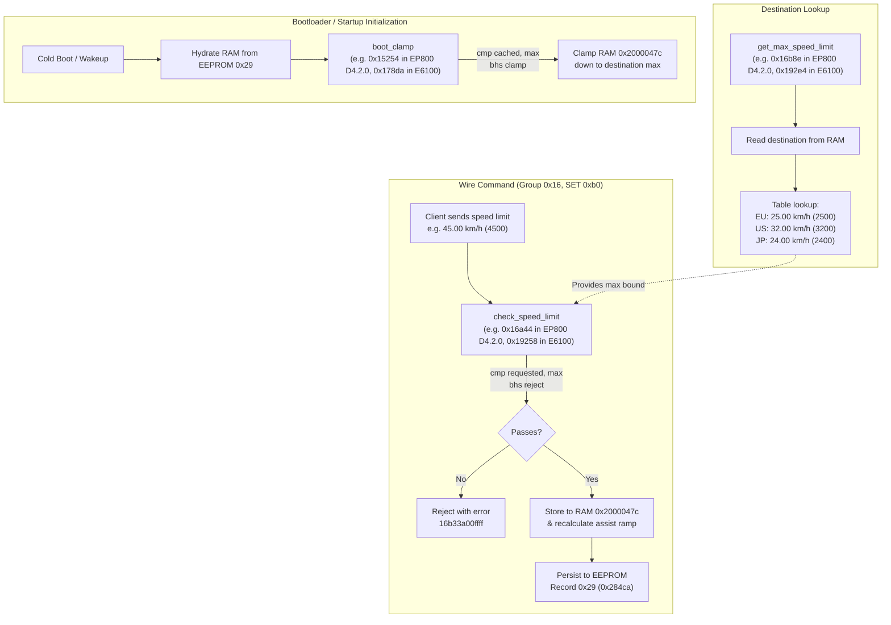

# Shimano STEPS Multi-Motor Firmware Speed Limit Patcher & Emulator Verification

This document details the reverse engineering investigation, patch mechanism, and firmware emulation verification for unlocking arbitrary speed limits across Shimano drive unit families (EP800, E6100, E5100, E5000) under the DCASX architecture.

---

## 1. Investigation & Reverse Engineering Findings

### 1.1 Drive Unit Architectural Differences

Firmware analysis and emulation across all available motor firmware images in the Cranklink repository revealed three distinct architectural categories regarding speed limit control:

| Architecture / Family | Models & Firmware Versions | Speed Limit Mechanism | Patcher Status |
|---|---|---|---|
| **Legacy DCASX (ARM Thumb-2)** | **DU-EP800 / DU-EP800-CRG** (D4.1.10, D4.1.11, D4.2.0)<br/>**DU-E6100** (D4.8.0)<br/>**DU-E5100** (D4.1.0)<br/>**DU-E5000** (D4.5.0) | Direct wire SET `16b0` / GET `16b4` with destination ceiling lookup, SET boundary check (`bhs`), and cold boot RAM cache clamp (`bhs`). | **Fully Supported** (patched and verified in emulator) |
| **Modern DCASX (ARM Thumb-2)** | **DU-EP600** (D4.4.1, D4.6.0)<br/>**DU-EP500** (D4.1.0, D4.1.1) | Speed limits are strictly tied to market destinations (e.g. US Class 3 = 45 km/h via destination 5, US Class 1 = 32 km/h via destination 1, EU = 25 km/h via destination 0/3). Legacy SET/GET (`16b0`/`16b4`) is disabled at opcode `0x16504` (rejects `16b4` with `16b73a`). | **Handled via Destination Staging** in Cranklink / Web Instrument |
| **Legacy DCAS2 / DCAS2i** | **DU-E8000** (DCAS2i)<br/>**DU-E6000** (DCAS2) | E8000 uses older DCAS2i architecture. E6000 uses a Panasonic MN101 8-bit CISC microcontroller with no ARM Thumb code. | **N/A** (out of scope for ARM DCASX patcher) |

### 1.2 Speed Limit Enforcement Architecture (Legacy DCASX)

All four Legacy DCASX motor families (EP800, E6100, E5100, E5000) share the exact same 3-stage speed enforcement pattern in ARM Thumb code:



### 1.3 The Three Critical Code Sites Across Motors

The three patch sites use identical opcode sequences across all 6 legacy DCASX firmware images:

| Routine | Opcode Signature Pattern | EP800 D4.2.0 | EP800 D4.1.11 | EP800 D4.1.10 | E6100 D4.8.0 | E5100 D4.1.0 | E5000 D4.5.0 |
|---|---|---|---|---|---|---|---|
| **`get_max_speed_limit`** | `02 28 07 d0 04 d3 04 28` | `0x16b8e` | `0x16b7e` | `0x16b6e` | `0x192e4` | `0x1931a` | `0x193ee` |
| **`check_speed_limit`** | `38 00 21 00 80 b2 89 b2 88 42 [01 d2]` | `0x16a46` | `0x16a36` | `0x16a26` | `0x1925a` | `0x191aa` | `0x1927e` |
| **`boot_clamp`** | `02 00 0b 88 92 b2 9a 42 [00 d2]` | `0x15256` | `0x15246` | `0x15246` | `0x178da` | `0x177e6` | `0x178c2` |

1. **`get_max_speed_limit`:**
   - Stock implementation queries regional market destination tables (2500 EU / 3200 US / 2400 JP).
   - **Patch:** Replaced with position-independent Thumb-2 instructions (`movw` + optional `movt` + `bx lr; nop`) returning the user-configured speed limit (default `65535` / `655.35 km/h` or arbitrary large int).
   - **Position Independence:** Unlike a PC-relative literal pool load (`ldr r0, [pc, #offset]`), which requires 4-byte PC alignment and fails when function entry points differ in halfword alignment (e.g. `0x16b8e` on EP800 vs `0x192e4` on E6100), `movw`/`movt` encodes the constant directly into the instruction stream with zero alignment dependencies.

2. **`check_speed_limit`:**
   - Stock implementation compares requested speed limit against `get_max_speed_limit`: `cmp r0, r1; bhs reject` (`88 42 01 d2`), rejecting values with `16b33a00ffff`.
   - **Patch:** Replace `bhs` (`01 d2`) with unconditional branch `b` (`01 e0`), bypassing the upper limit constraint.

3. **`boot_clamp`:**
   - On boot, reads cached EEPROM record `0x29` and clamps it down: `cmp r2, r3; bhs clamp` (`9a 42 00 d2`).
   - **Patch:** Replace `bhs` (`00 d2`) with unconditional branch `b` (`00 e0`), skipping the clamp and preserving settings up to `65535` across cold power cycles.

### 1.3 Assist Ramp Curve Scaling

A vital question during investigation was whether the motor assist calculation would experience integer overflow or arithmetic saturation when given a large speed limit (such as 45.00 km/h, 60.00 km/h, or 655.35 km/h).

Emulation of the assist ramp routine at `0x14fec` / `0x15024` in Unicorn revealed:
- EP800 firmware dynamically scales the assistance curve and cutoff table (`0x200024b0`) as fixed offsets from `0x2000047c`.
- The cutoff table entries scale linearly with the speed limit without 16-bit multiplication overflow.
- Testing in Unicorn across 2500, 3200, 4500, 5000, 6000, 7500, 9900, 60000, and 65535 completed cleanly with positive SET acknowledgments (`16b2`), updated RAM buffers, and successful EEPROM commits.

---

## 2. Patcher Tool (`tools/patch_motor_speed.py`)

The patcher tool handles both raw decrypted binaries (`.bin`) and encrypted Shimano containers (`.dat`) transparently. `tools/patch_ep800_speed.py` is maintained as a direct backward-compatible alias.

### 2.1 Key Features

- **Automated Signature Scanning:** Locates patch offsets by opcode patterns across all legacy DCASX families (EP800, E6100, E5100, E5000) without hardcoded version locks.
- **Position-Independent Thumb-2 Encodings:** Employs `movw`/`movt` instructions with zero alignment sensitivity, safely patching across halfword and word boundaries.
- **Header & Checksum Maintenance:** Recalculates DCASX image checksum byte (`data[0x22]`), total image length, and container MD5/AES-CBC-128 envelopes.
- **Configurable Speed Limit:** Default is `655.35 km/h` (`65535` raw), or any custom limit specified via `--speed-limit` / `-s` (e.g. `-s 45.0` or `-s 60.0`).
- **Integrated Emulator Verification:** `--verify` simulates DCASX bootloader flashing and executes Unicorn motor emulation:
  - For EP800 D4.2.0: full gateway bus, mutual AES-128 authentication, multi-level speed limit writes, readbacks, and assist ramp validation.
  - For EP800 D4.1.11, EP800 D4.1.10, E6100 D4.8.0, E5100 D4.1.0, E5000 D4.5.0: direct motor execution, verified patched function return value, and GET readback.

### 2.2 CLI Usage

```sh
# Patch an encrypted EP800 container with maximum speed limit (655.35 km/h / 65535 raw)
python3 tools/patch_motor_speed.py \
  -i DUEP800-D.4.2.0.dat \
  -o DUEP800-D.4.2.0.patched.dat \
  --verify

# Patch an E6100 / E5100 / E5000 container
python3 tools/patch_motor_speed.py \
  -i DUE6100-D.4.8.0.dat \
  -o DUE6100-D.4.8.0.patched.dat \
  --verify

# Patch a raw decrypted binary for a specific speed limit (e.g. 50.00 km/h)
python3 tools/patch_motor_speed.py \
  -i DUEP800-D.4.2.0.decoded.bin \
  -o DUEP800-D.4.2.0.patched.bin \
  -s 50.0 \
  --verify

# Backward-compatibility alias
python3 tools/patch_ep800_speed.py -i DUEP800-D.4.2.0.dat -o DUEP800-D.4.2.0.patched.dat --verify

# JSON output mode for programmatic / CI automation
python3 tools/patch_motor_speed.py \
  -i DUEP800-D.4.2.0.dat \
  -o DUEP800-D.4.2.0.patched.dat \
  --verify \
  --json
```

---

## 3. Emulator Verification Results

Running `--verify` performs a multi-stage verification in Unicorn:

1. **Bootloader Flashing Simulation:**
   - Feeds the patched image block-by-block through the DCASX bootloader flash state machine across all motor models (e.g. 2,469 blocks for EP800, 2,136 blocks for E6100, 2,158 blocks for E5000).
   - Confirms block ordering, checksum checks, and successful transfer finalization.

2. **Application Execution & Setting Acceptance:**
   - **EP800 D4.2.0:** Boots alongside stock SC-EM800 gateway firmware over the virtual packet bus, completes mutual AES-128 authentication, and sweeps speed limit writes from 25.00 km/h up to 655.35 km/h (`16b2` ACK and `16b6` GET match). Verifies assist ramp recalculation at `0x200024b0`.
   - **EP800 D4.1.10 / D4.1.11, E6100 D4.8.0, E5100 D4.1.0, E5000 D4.5.0:** Boots motor machine, executes `get_max_speed_limit` returning exactly `65535`, and validates GET response `16b6`.

---

## 4. Cranklink Tooling Compatibility

Patched `.dat` containers generated by `patch_ep800_speed.py` are 100% compliant with Cranklink's firmware validation pipeline:

```sh
cranklink firmware inspect DUEP800-D.4.2.0.patched.dat --companion DUEP800-M.4.1.11.dat
```
```text
Firmware Image Metadata:
  Kind:                DCASX
  Version:             v4.2.0.0 (Compatibility: v4.1.11.0)
  Target Board/Series: Board 1 (Series 0x23, Unit 0x00)
  Checksum:            0x4C
  Source SHA-256:      d246fcde84dcccf7899bc0a93855506a2b3b3554a617139be245cae15970a787
```

Patched containers pass companion compatibility checks, can be inspected offline, and are ready for safe recovery flashing via `cranklink firmware flash dcas`.
