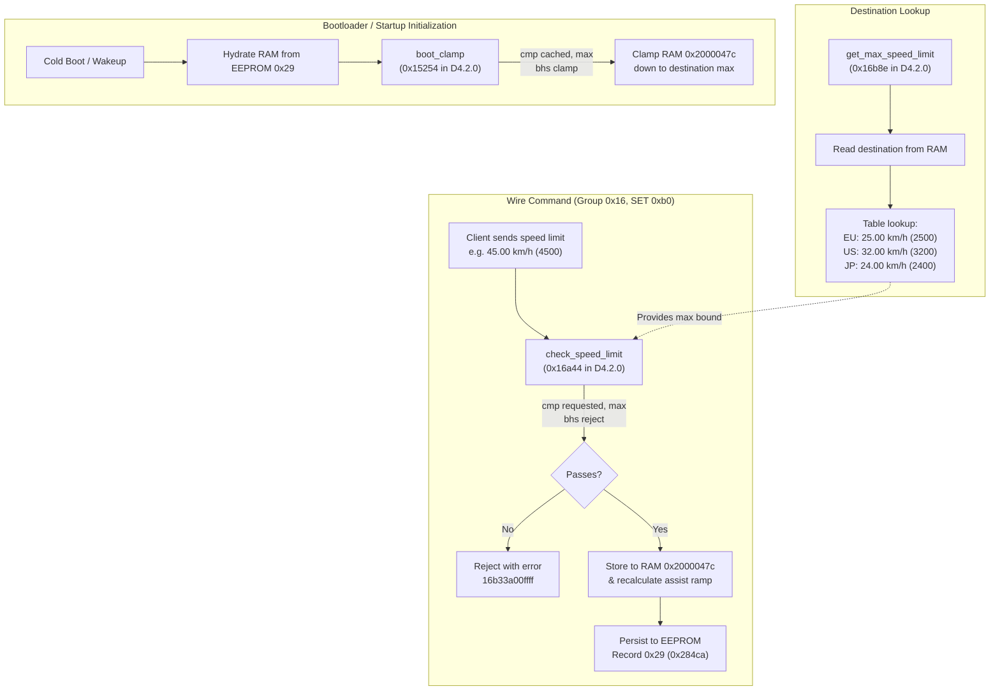

# EP800-CRG Speed Limit Firmware Patcher & Emulator Verification

This document details the reverse engineering investigation, patch mechanism, and firmware emulation verification for unlocking arbitrary speed limits on Shimano DU-EP800 / DU-EP800-CRG drive units (DCASX architecture, Board 1).

---

## 1. Investigation & Reverse Engineering Findings

Stock EP800 motor firmware (versions D4.1.10, D4.1.11, and D4.2.0) enforces regional speed limit restrictions across three distinct routines in ARM Cortex-M Thumb code.

### 1.1 Speed Limit Enforcement Architecture



### 1.2 The Three Critical Code Sites

1. **`get_max_speed_limit` (`0x16b8e` in D4.2.0; `0x16b7e` in D4.1.11; `0x16b6e` in D4.1.10):**
   - Stock implementation loads the configured market destination and indexes a ceiling table (2500 for EU, 3200 for US, 2400 for JP).
   - If unpatched, callers using this ceiling continue to constrain the motor.
   - **Patch:** Replaced with a Thumb-2 literal load returning the user-configured speed limit (default `65535` / `655.35 km/h` or arbitrary large int):
     ```armasm
     ldr r0, [pc, #4]   ; 01 48
     bx lr              ; 70 47
     nop                ; 00 bf (alignment)
     .word <LIMIT>      ; e.g. 0x0000ffff (65535 raw)
     ```

2. **`check_speed_limit` in SET 0xb0 handler (`0x16a44` in D4.2.0; `0x16a34` in D4.1.11; `0x16a24` in D4.1.10):**
   - Stock implementation calls `get_max_speed_limit`, then executes `cmp r0, r1; bhs #0x16a4c` (`88 42 01 d2`), rejecting requested speed limits greater than or equal to the ceiling with error code `16b33a00ffff`.
   - **Patch:** Replaced `bhs` (`01 d2`) with an unconditional branch `b #0x16a4c` (`01 e0`), bypassing the upper ceiling check entirely.

3. **`boot_clamp` in initialization (`0x15254` in D4.2.0; `0x15244` in D4.1.11/4.1.10):**
   - On boot, the motor reads EEPROM record `0x29` into RAM `0x2000047c`. It then calls `get_max_speed_limit` and clamps the cached speed limit down to destination max if higher: `cmp r2, r3; bhs #0x1525a` (`9a 42 00 d2`).
   - If only `check_speed_limit` was patched, any value set above the ceiling would be reset on the next reboot.
   - **Patch:** Replaced `bhs` (`00 d2`) with unconditional branch `b #0x1525a` (`00 e0`), skipping the clamp and preserving values up to `65535` across power cycles.

### 1.3 Assist Ramp Curve Scaling

A vital question during investigation was whether the motor assist calculation would experience integer overflow or arithmetic saturation when given a large speed limit (such as 45.00 km/h, 60.00 km/h, or 655.35 km/h).

Emulation of the assist ramp routine at `0x14fec` / `0x15024` in Unicorn revealed:
- EP800 firmware dynamically scales the assistance curve and cutoff table (`0x200024b0`) as fixed offsets from `0x2000047c`.
- The cutoff table entries scale linearly with the speed limit without 16-bit multiplication overflow.
- Testing in Unicorn across 2500, 3200, 4500, 5000, 6000, 7500, 9900, 60000, and 65535 completed cleanly with positive SET acknowledgments (`16b2`), updated RAM buffers, and successful EEPROM commits.

---

## 2. Patcher Tool (`tools/patch_ep800_speed.py`)

The patcher tool handles both raw decrypted binaries (`.bin`) and encrypted Shimano containers (`.dat`) transparently.

### 2.1 Key Features

- **Automated Signature Scanning:** Locates patch offsets by opcode patterns, supporting EP800 D4.2.0, D4.1.11, and D4.1.10 without hardcoded version locks.
- **Header & Checksum Maintenance:** Recalculates DCASX image checksum byte (`data[0x22]`), total image length, and container MD5/AES-CBC-128 envelopes.
- **Configurable Speed Limit:** Default is `655.35 km/h` (`65535` raw), or any custom limit specified via `--speed-limit` / `-s` (e.g. `-s 45.0` or `-s 60.0`).
- **Integrated Emulator Verification:** `--verify` simulates DCASX bootloader flashing and executes full Unicorn motor emulation with unit authentication, multi-level speed limit writes, readbacks, and assist ramp validation.

### 2.2 CLI Usage

```sh
# Patch an encrypted container with maximum speed limit (655.35 km/h / 65535 raw)
python3 tools/patch_ep800_speed.py \
  -i DUEP800-D.4.2.0.dat \
  -o DUEP800-D.4.2.0.patched.dat \
  --verify

# Patch a raw decrypted binary for a specific speed limit (e.g. 50.00 km/h)
python3 tools/patch_ep800_speed.py \
  -i DUEP800-D.4.2.0.decoded.bin \
  -o DUEP800-D.4.2.0.patched.bin \
  -s 50.0 \
  --verify

# JSON output mode for programmatic / CI automation
python3 tools/patch_ep800_speed.py \
  -i DUEP800-D.4.2.0.dat \
  -o DUEP800-D.4.2.0.patched.dat \
  --verify \
  --json
```

---

## 3. Emulator Verification Results

Running `--verify` performs a two-stage verification in Unicorn:

1. **Bootloader Flashing Simulation:**
   - Feeds the patched image block-by-block through the DCASX bootloader flash state machine (erase sector 77, 2,469 blocks of 64 bytes, 157,996 bytes total).
   - Confirms block ordering, checksum checks, and successful transfer finalization.

2. **Application Execution & Setting Acceptance:**
   - Boots the patched motor alongside stock SC-EM800 gateway firmware over the virtual packet bus.
   - Negotiates PC-link mode and completes mutual AES-128 authentication.
   - Issues `16b0` SET commands across multiple speed levels and validates responses:
     - `25.00 km/h ( 2500)`: `SET 16b0c40901ff` -> `ACK 16b2c409ffff` (GET matches)
     - `32.00 km/h ( 3200)`: `SET 16b0800c01ff` -> `ACK 16b2800cffff` (GET matches)
     - `45.00 km/h ( 4500)`: `SET 16b0941101ff` -> `ACK 16b29411ffff` (GET matches)
     - `50.00 km/h ( 5000)`: `SET 16b0881301ff` -> `ACK 16b28813ffff` (GET matches)
     - `60.00 km/h ( 6000)`: `SET 16b0701701ff` -> `ACK 16b27017ffff` (GET matches)
     - `655.35 km/h (65535)`: `SET 16b0ffff01ff` -> `ACK 16b2ffffffff` (GET matches)
   - Verifies EEPROM record `0x29` commit and assist ramp recalculated output at `0x200024b0`.

---

## 4. Cranklink Tooling Compatibility

Patched `.dat` containers generated by `patch_ep800_speed.py` are 100% compliant with Cranklink's firmware validation pipeline:

```sh
cranklink firmware inspect DUEP800-D.4.2.0.patched.dat --companion DUEP800-M.4.1.11.dat
```
```text
Firmware Image Metadata:
  Kind:                DCASX
  Version:             v4.2.0.0 (Compatibility: v4.1.11.0)
  Target Board/Series: Board 1 (Series 0x23, Unit 0x00)
  Checksum:            0x4C
  Source SHA-256:      d246fcde84dcccf7899bc0a93855506a2b3b3554a617139be245cae15970a787
```

Patched containers pass companion compatibility checks, can be inspected offline, and are ready for safe recovery flashing via `cranklink firmware flash dcas`.
