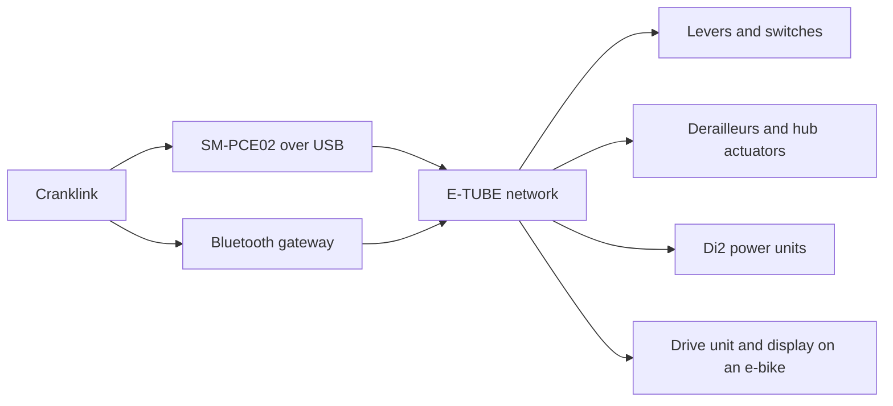

# Understanding E-TUBE with Cranklink

When Cranklink inspects a bike, it first discovers the connected components
and asks them to identify themselves. The answers establish which component
is a derailleur, a switch, a display or a drive unit. Cranklink can then choose
the operations it implements for that component.

That distinction runs through E-TUBE: reaching a component, identifying it and
knowing how to operate it are separate steps. This guide follows those steps,
explains how they appear in traffic, and points to the implementation for exact
byte layouts. Read it in order for the command lifecycle, or use the
[wire reference](#wire-reference) to interpret a capture or implement a host.

## The components and their roles

E-TUBE connects electronic components in Di2 shifting systems and Shimano
e-bike systems. A Di2 bike can contain levers, switches, derailleurs and a
battery unit; an e-bike can add a drive unit, assist controls and a display.
The allowed combination depends on the system and its firmware.

Cranklink reaches the network through a connection device. Over USB, an
SM-PCE02 carries its commands. Over Bluetooth, a compatible gateway provides
the radio connection and forwards service commands to other components.
A gateway can be part of another component, such as a display or wireless
unit; the connection role and the component's everyday function are distinct.



This shows the logical command path across different system types. It does
not imply that all the pictured components belong on one compatible bike.
Shimano's [Di2](https://productinfo.shimano.com/en/compatibility/C-473) and
[e-bike](https://productinfo.shimano.com/en/compatibility/C-525) charts describe
the permitted combinations. EW-SD50 and EW-SD300 identify wiring and connector
systems; adapting a connector alone does not establish compatibility.

Other conversations sit alongside E-TUBE service traffic. A traction battery
has its own motor and charger interface. Some drive units contain separate
controllers, called D and M, that communicate internally. Wireless shifters
and cycle-computer broadcasts introduce radio protocols too. Each observation
point needs its own interpretation: USB bytes, Bluetooth records and signals
on a component's wiring expose different parts of the system.

## Discovering components

`cranklink units` is the starting point for a component inventory. With an
SM-PCE02 selected explicitly, the command is:

```sh
cranklink --port usb units
```

The connection device discovers temporary addresses called **slots**.
Cranklink reads the identity at each relevant slot and records the current
map. A component can receive a different slot after another discovery or
power cycle, even if the set of occupied slots looks unchanged.

A stock identity contains a **series number** and **unit number**. These
identify a model or a set of candidates. Some components need another query
for a part code or product attributes before Cranklink can resolve the name.
Unknown values remain unknown, and ambiguous identities retain their candidate
list.

A Di2 rear derailleur provides a useful example. In Cranklink's catalog, stock
identity `07 04` leaves two candidates: RD-6870-GS and RD-6870-SS. A part query
distinguishes them: part `01` selects GS and `00` selects SS. Cranklink has now
identified the derailleur; it has not gained a gear-control implementation.
The [component catalog and identity resolver](../src/unit_models.rs) contain
the complete mapping and the queries used to refine it.

The slot answers where the component is **in this discovery**. Its model
answers what kind of component it is. Its serial, where available, identifies
the individual component. None of those can substitute for the others.

### What identification enables

Cranklink's catalog covers more component types than its settings and firmware
commands. These examples show how to interpret a recognized name:

| Component type | Examples in the catalog | What Cranklink's recognition establishes |
| --- | --- | --- |
| Di2 derailleurs | Road, MTB and GRX front/rear derailleurs | Series/unit identity and applicable part refinement. |
| Levers and switches | ST-6770, ST-R9270, SW-M8050, SW-EM800 | Component identity, including side or part code where defined. |
| Di2 batteries and mounts | SM-BMR1/BMR2, BM-DN100, BT-DN110/DN300 | Identity of the electronic power unit. |
| Hub and hub actuators | FH-U6060, MU-S705, MU-UR500/510/520 | Model identities from the component catalog. |
| Displays, wireless units and suspension components | SC-EM800, EW-WU111 and numbered suspension units | Known model identities. |
| Drive units | EP-series and E-series families | Stock identity and available product attributes. |

A resolved name records identity. Gear control, settings and firmware updates
need separate implementations and validation for the component. Cranklink
supports model-specific settings for selected classic Di2 levers, derailleurs,
power units, MU hub actuators and cycle computers. Inspect
`settings schema --model <COMPONENT>` and the [settings guide](settings.md).
Firmware update paths remain scoped to selected drive units.

Even unit number `00` is insufficient to identify a motor: Di2 batteries and
other components use it too. Cranklink's motor paths check the complete
family identity. Some catalogued drive units, including E5000/E5080, are not
admitted by the current motor-operation gate.

Likewise, SM-PCE1 appearing in the catalog does not mean Cranklink implements
its host transport. Catalog membership describes names Cranklink can resolve
when an identity is available, rather than hardware certification of every
listed component. See [`UnitIdentity` and the motor gate](../src/device.rs)
and [motor capabilities](../src/motor_support.rs) for those decisions.

## Following an identity query

Cranklink's ordinary component requests name a target, a command group and
an operation, followed by parameters. Suppose discovery places a component
at slot 4. Its stock-identity query is:

```text
04 01 1C 00
```

Byte strings here are hexadecimal. The fields mean:

| Bytes | Meaning |
| --- | --- |
| `04` | Address the component currently at slot 4. |
| `01` | Use the group containing the stock-identity command. |
| `1C` | Request stock identity. |
| `00` | Supply this query's parameter. |

A reply body beginning `01 1E 07 04` means the stock-identity reply (`01/1E`)
reports series `07`, unit `04`, as in the RD-6870 example. The subsequent part
query uses `32/9C 00` and expects `32/9E`. These are identity reads; they are
unrelated to commanding the derailleur to move.

The connection adds its own packaging. Through SM-PCE02, the request becomes:

```text
BB 48 04 01 1C 00 97 BB
```

`BB` marks each frame boundary, `48` identifies a normal routed command, and
`97` is an additive checksum. A short USB write also has trailing `FF` padding
outside the frame. The [frame codec](../src/protocol.rs) specifies escaping,
checksum calculation, padding and decoding across arbitrary serial reads.

Over Bluetooth, the gateway offers a FREE command channel for component
requests. In BLE terminology, that channel is a **characteristic**. A direct
FREE query carries the target and command as one value, without USB framing.
Some discovery queries instead use the gateway's cache; the
[BLE session implementation](../src/ble.rs) selects the appropriate route.

One detail is easy to miss in captures: **the reply address depends on the
connection**. A normal USB reply is addressed to the PC's slot. A BLE FREE
notification identifies the component whose reply it carries. Cranklink must
retain the discovery map and connection context to interpret either correctly.

## From discovery to a service session

Discovery and identity form the shared starting point. What happens next
depends on the component and operation. Cranklink's wired `units` inventory
does not start a motor PC-link session. Bluetooth discovery can also require
gateway setup and role changes, so its traffic is not identical to the wired
inventory.

Default `probe`, motor settings and motor firmware paths require a recognized
drive unit. Explicit `--component` or slot selection also permits probes and
supported settings on a uniquely identified catalogued component. Catalog
recognition does not grant every operation. For motor settings, the sequence is:

```text
Discover → select motor → open service session → finish identification
         → read or change settings → close service session
```

The **PC-link session** is the component's service connection. Startup includes a
fixed sequence of keys and a component acknowledgment. Cranklink completes the
model and firmware checks needed for the requested operation, then sends the
command. At the end, it asks the motor to stop and checks the acknowledgment.
Opening a serial port or establishing Bluetooth is only the transport step.

There can also be separate permissions. Bluetooth gateway authentication uses
the bike's passkey to obtain gateway access. Motor authorization permits
protected settings on families and firmware that require it. PC-link startup,
gateway authentication and motor authorization are different exchanges.
The [authorization policy](../src/motor_support.rs) and
[key derivation and receipts](../src/ble/unit_auth.rs) define the motor-specific
requirements; they should not be applied to Di2 components merely because
those components share the network.

Ownership matters during that session. A Bluetooth gateway in master mode can
start the motor's session on Cranklink's behalf. Cranklink consumes the existing
acknowledgment instead of starting twice. It retains the address and ownership
state across related operations, then releases the motor and restores gateway
routing during cleanup. The details live beside the
[wired session](../src/device.rs) and [BLE lifecycle](../src/ble.rs).

Ordinary service requests run one at a time. Their replies have no general
transaction identifier to distinguish concurrent requests for the same
operation. One session owner must coordinate discovery, routing, pending
replies and cleanup.

## Changing a value and confirming the result

Each component-specific operation has its own read and write rules. Cranklink's
named motor settings provide an example of how those rules affect a change.

For example, the EP800 lamp setting uses values `0` for off, `1` for switch
controlled and `2` for always on. Cranklink first reads and saves the original
value with the motor identity, sends the requested value, and reads it again:

```text
Read lamp → reports 0
Save the original value and motor identity
Set lamp to 2 → receive the motor's response
Read lamp again → reports 2
```

The write response reports the command's result. The following read checks
the value now exposed by the motor. To check persistence, end the session,
power-cycle the bike and read in a new session.

Some settings share their payload with neighboring fields. Cranklink reads
the complete group, changes the requested field and preserves its neighbors.
Reserved bytes in a GET reply can differ from the bytes required by SET, so
copying a reply back unchanged is insufficient. The [`SettingSpec` layouts,
payload construction and profile-name handling](../src/settings.rs) keep these
rules alongside the model schemas. The [settings guide](settings.md) explains
the CLI's authorization, backup and restore behavior.

A lost reply creates an uncertain outcome: the motor may have applied the
write before communication failed. Cranklink must re-establish a known session
and read the value before deciding whether another write is needed. The same
reasoning matters for an external integration: automatically replaying a
timed-out command can repeat an operation that already succeeded.

## Reading traffic and recognizing updates

Start with the recording's observation point. USB captures contain adapter
frames; BLE captures contain characteristic records. Neither directly supplies
the electrical frame format on the E-TUBE cable. In particular, the SM-PCE02
host serial rate is not the cable's signaling rate.

Keep direction, timestamps, model, board, firmware and the current discovery map
with the raw recording. Retain unknown opcodes and status bytes without assigning
them an invented meaning. Redact credentials and private identities before
sharing traces.

Next, find discovery and any startup required by the operation. Discovery
establishes the current slot map; motor-session startup adds ownership context.
Gateway role changes can also alter routing. Correlate a reply with its command group,
operation, parameters and route. A single serial read can contain part of a
frame or several frames, and fragmented messages need reassembly before their
contents make sense.

Firmware updates introduce another conversation: boot entry, numbered blocks,
checksums, completion and application return. An adapter can acknowledge that
it buffered data before the component has checked or programmed it. Cranklink
therefore distinguishes transfer acceptance, transfer completion, component
checksum, finish and reset receipts.

Cranklink's implemented motor update paths include D/DCAS and M/RX. Ordinary
RX relay and SM-PCE02 fast RX use different envelopes and block sizes; a BLE
motor relay is also separate from updating the gateway's own radio. The exact
contracts are documented beside the [shared D writer](../src/firmware_io.rs),
[RX transports](../src/rx.rs) and [BLE motor relay](../src/ble/firmware.rs).
The [firmware metadata and target checks](../src/firmware.rs) determine which
images and families those writers admit.

## Deciding what a custom integration needs

The work depends on where the integration joins the system:

| Integration | What it must implement |
| --- | --- |
| A host using SM-PCE02 | Host framing, discovery, routing and the sessions and commands for its chosen components. |
| A host using an existing BLE gateway | GATT access, gateway authentication, routing and component-specific sessions and commands. |
| A replacement display, switch or derailleur on the cable | The electrical interface, network participation, power behavior and normal operating messages, plus any service commands it exposes. |
| A replacement traction battery | Its battery generation's startup, acceptance, telemetry, limits, faults and power-control behavior. |

Cranklink's service implementation is a concrete starting point for the first
two. A physical replacement also needs the operating traffic that makes the
component function on a bike: switch events, gear requests and actuator status,
or the corresponding assist, power and fault messages. These are separate
from reading a component's identity or configuration.

The gateway simulator's four-byte FIFO fragments describe one firmware
boundary. They do not establish the complete wire format or electrical
behavior needed for a drop-in component. The
[gateway reassembly code](../tools/firmware-sim/fw_sim/gateway.py) shows exactly
which boundary is modeled. Traction BMS, wireless shifting, ANT/D-FLY and the
motor's internal D–M connection likewise need their own protocol treatment.

## Wire reference

Byte strings and command numbers below are hexadecimal; counts, ranges and
times are decimal. `group/opcode` names an ordinary component command, while
an adapter control belongs to the surrounding transport. `LE16` and `LE32`
mean little-endian integers. Array offsets are zero-based.

### USB adapter and discovery

The SM-PCE02 serial path uses 2,000,000 baud, 8N1, asserted RTS and no CTS flow
control. Cranklink uses a 500 ms write timeout. Its native USB path carries the
same framed stream; these settings do not describe the E-TUBE cable. See
[port configuration](../src/platform.rs#L1) and the [frame codec](../src/protocol.rs#L1).
The codec escapes both data and FCS, pads short writes to 128 bytes, and accepts
split or coalesced receive frames. Longer writes are not rounded to a multiple
of 128. Invalid escapes, checksums and oversized frames are rejected.

| Adapter control / parameters | Reply control | Interpretation |
| --- | --- | --- |
| `10` | `30` | Initialize; first reply parameter must be `00`. |
| `1A 01` | `3A` | Unlock power limit; reply parameter 1 must be `00`. |
| `1A 02` | `3A` | Power query; parameters begin `02 state`. |
| `1A 03` | `3A` | Enable adapter supply; reply parameter 1 must be `00`. |
| `1C` | `3C` | Capacitor level, first two parameters LE16. |
| `03 mode` | `23` | Select protocol/role; normal USB acceptance is `00`. |
| `04` | `24` | Read resulting mode and local slot. |
| `05` | `25` | Adapter revision. |
| `06 slot` | `26` | Select component; `00` means success. |
| `1D 00` | `3D` | Master discovery/PnP; accepted parameters begin `00 00`. |
| `1B` | `3B` | Master connected-slot bitmap, at least four bytes. |
| `07 subcommand [mask]` | `27` | Fast bridge control; masks, when present, are LE32. |

Normal/master requests mode `20` and expects `A0 | pc_slot`; update/master
requests `60` and expects `E0 | pc_slot`. Low five bits hold the local slot.
Slot `i` occupies bitmap byte `i/8`, bit `i%8`, for slots 0–31. The simulator's
virtual broadcast target 63 is outside this USB target-selection range.

Power state `01` indicates external supply, `02` permits adapter supply, and
`03/04` require charging. Cranklink polls every 3 s for raw capacitor level
at least 2703 and ready state `01/02`, with a 90 s limit. No voltage unit is
established for that raw threshold. Reset, protocol change and PnP waits are
3 s, 1 s and 5 s respectively: host pacing policies, not measured bus minima.
Adapter supply does not establish traction power or assist readiness. The
[initialization sequence](../src/device.rs#L339) preserves those distinctions.

### Component identity and diagnostic reads

Normal USB requests contain `[target,group,opcode,parameters…]`; replies contain
`[pc_slot,group,reply_opcode,parameters…]`. In the ordinary service families
below, success is request opcode +2 and error is +3. Adapter and boot commands
have their own reply rules. Validate route, group, opcode, length and echoed
selectors together.

| Request / parameters | Success | Meaning and scope |
| --- | --- | --- |
| `01/1C 00` | `01/1E` | Stock series/unit identity. |
| `04/0C 00` | `04/0E` | Switch/lever part discriminator where supported. |
| `32/9C 00` | `32/9E` | Derailleur part discriminator where supported. |
| `16/7C 00` | `16/7E` | Product/model attributes on supported motors. |
| `01/2C 00` | `01/2E` | D application version on the newer supported path. |
| `01/84 01` | `01/86` | M/RX application version/cache on that path. |
| `01/3C 00` | `01/3E` | Six binary serial bytes; optional reserved seventh `FF`. |
| `01/A4 00`, `01/AC 00` | `01/A6`, `01/AE` | Two product-serial pieces on supported modern motors. |
| `26/4C 00` | `26/4E` | Motor's cached battery type/product/fix diagnostic. |
| `26/44 00` | `26/46` | Battery-related diagnostic; full semantics remain unresolved. |
| `32/8C address,count,00` | `32/8E` | Bounded EP800-CRG memory read, described below. |

The battery diagnostic rows describe tested motor handlers, not generic commands
implemented for every battery or a complete BMS exchange. Product attributes
can be binary. Preserve their bytes rather than assuming text.

Three version bytes `v0 v1 v2` decode as `(v0>>4).(v0&15).v1.v2`:
`42 00 00` is 4.2.0.0. Binary serial bytes retain wire order. Modern product
serials instead join first-reply bytes `[1:6]` with second-reply bytes `[0:6]`
and require printable ASCII without spaces. Filenames may omit a version
revision; the shared EP600/EP801 distribution family does not establish the
live component model.

Older E6000-family identities also differ from some historical catalog aliases.
The [catalog caveat](../src/unit_models.rs#L270) describes that limitation;
an alias must not grant another model's operations. Version selectors and cache
requirements are firmware-specific too. The [simulator fixtures](firmware-simulator.md)
now initialize the stock M/RX and product caches missing from earlier bare-D
fixtures; clearing the version cache reproduces the earlier E6100 `01/2C`
rejection. This initializes data consumed by unchanged instructions, without
executing M firmware or complete board boot.

The [bounded memory reader](../src/bootloader_dump.rs#L259) uses
`[addr_hi,addr_lo,addr_mid,count,00]`, with count 1–3. Reply parameters echo
those three address bytes and carry the data in a six-byte record, optionally
followed by reserved `FF`. This normal-application read does not enter boot
mode. Its EP800-CRG model, board, D/M versions, 64 KiB resident range and
reviewed sample windows are enforced by the reader.

### Bluetooth records and session ownership

The service UUID is `000018ff-5348-494d-414e-4f5f424c4500`. Replace its first
eight digits with `0000` plus a short ID below for each characteristic UUID.

| Short ID | Role | Value format |
| --- | --- | --- |
| `2AF3` | Authentication control | Proof writes; authentication notifications. |
| `2AF4` | Authentication nonce | Challenge read. |
| `2AF9` | PCE response | `[reply_control,parameters…]`. |
| `2AFA` | PCE command | Short record `[00,control,parameters…]`. |
| `2AFD` | FREE response | `[component_slot,group,reply_opcode,parameters…]`. |
| `2AFE` | FREE command | `[target_slot,group,opcode,parameters…]`. |
| `2AFF` | Feature control | Access check `FF 00`; other values can change mode. |

Discover each characteristic's actual properties. These values have no USB
framing. Cranklink's ordinary parameter limits are 16 bytes for gateway commands
and 15 for component commands; they are client limits, not universal GATT maxima.
Large firmware records use a separate [fragment codec](../src/ble/firmware.rs#L1).

The [gateway proof calculation](../src/ble.rs#L159) and
[authentication sequence](../src/ble.rs#L417) document nonce padding,
proof construction, subscriptions and receipts. A six-digit passkey preserves
leading zeroes. When both auth characteristics are absent, the client uses the
supported unauthenticated service shape; finding only one is an error.

Slave discovery reads the master's routed `01/14` bitmap and `02/14` identity
cache. Master discovery uses PCE PnP and `1B`, and can start motor PC-link itself.
The [slave discovery](../src/ble.rs#L519) and [master discovery](../src/ble.rs#L575)
methods explain master-slot inclusion, cache selection and the existing start
receipt. [Cleanup](../src/ble.rs#L828) orders motor stop,
slave-mode restoration/readback, gateway stop and GATT close; gateway stop can
end connection mode. Keep ownership until explicit disconnect.

### Motor settings and update traffic

Motor PC-link uses `32/10` start/stop and `32/30` keys, with `32/12` receipts.
The [wired startup sequence](../src/device.rs#L563) specifies the five keys, source
address and timing. Protected settings use a separate exchange: legacy
`16/D8,DA,E0,E2` or modern `33/68,6A,70,72`. The
[authorization contract](../src/ble/unit_auth.rs#L1) describes derivation, fragment
selectors and receipt filler; [motor policy](../src/motor_support.rs) selects
the family and firmware rules.

For setting names, choices, units and ranges, run
`cranklink settings schema --model ep800`. For wire layouts, read
[`SettingSpec`](../src/settings.rs#L257), the [base schema](../src/settings.rs#L427)
and [model overrides](../src/settings.rs#L116):
`group`, `set`, `get` and `query` select the exchange; `template`, `offset`,
`width`, `scale` and `preserve` define the payload. Those wire fields are not
exported by the CLI schema. [`updated_payload`](../src/settings.rs#L1336)
reconstructs SET bytes, while [`read_raw`](../src/settings.rs#L938) and
[`set_name`](../src/settings.rs#L1679) handle split names. This keeps every setting's layout
beside its implementation rather than maintaining a second field dictionary.

Read the complete shared payload and preserve sibling fields. On tested EP800,
speed GET selector `0` aliases effective speed, and destination GET selector
`0` can be rejected; modern factory fallback must not be copied to that path.
The [destination validation](../src/settings.rs#L1212) handles unset `FF` explicitly.
The implemented settings path has no extra generic EEPROM commit. Profile
names span two writes and can partially complete; read both chunks after an
interruption. A batch can also leave earlier writes applied.

| Observed transport/control | Traffic to recognize | Detailed contract |
| --- | --- | --- |
| D boot `88` | Five update keys; identity, erase, address, finish and reset commands. | [Entry](../src/device.rs#L923), [boot identity](../src/firmware_io.rs#L60), [programming commands](../src/firmware_io.rs#L93). |
| D data `0B` | 64-byte buffers; separate `82`, `83`, `C0` and motor `31` receipts (indexed on DCAS2i/X). | [DCAS writer](../src/firmware_io.rs#L93). |
| Fast bridge `A8` | Addressed 16-byte command envelopes; slot stays in the record. | [Fast RX envelope](../src/rx.rs#L190). |
| Normal RX `48` | `F0` command relay and `F8` four-byte fragments. | [Ordinary RX relay](../src/rx.rs#L561). |
| Fast RX `11` | 60 image bytes plus four adapter filler bytes; separate receipt IDs. | [Fast RX data](../src/rx.rs#L236). |
| BLE PCE / FREE | D relay on PCE; ordinary RX relay on FREE, distinct from gateway radio DFU. | [BLE relay and terminal fragments](../src/ble/firmware.rs#L1). |

The writers document their block sizes, sequence wrap, padding, checksum windows
and completion rules. Boot-capability reads can enter update mode. Match image
family, board, bootloader and companion requirements before entry; fresh normal
D/M reads after reset are a separate result from a finish receipt.

### Worked capture fragments

These USB records end at the closing delimiter; short writes append `FF` to
128 bytes. Slot 13 is an example discovered address.

```text
motor attributes GET: BB 48 0D 16 7C 00 19 BB
lamp GET:             BB 48 0D 10 14 00 87 BB
escaping fixture:     BB 48 BD 9B BD 9D 40 BB
```

The escaping fixture carries literal payload `BB BD`; it is codec data. A
gateway FIFO instead carries three data bytes per four-byte fragment:
`[flags|sequence,data0,data1,data2]`, first flag `80`, last flag `40`, sequence
starting at 1 and unused data filled with `FF`.

```text
16 7E 30 30 2D 43 52 47 00
→ 81 16 7E 30 | 02 30 2D 43 | 43 52 47 00
single-fragment lamp reply: C1 10 16 00
```

The [FIFO fixture](../tools/firmware-sim/fw_sim/gateway.py#L5) supplies routing
separately and admits 2–9-byte messages at slot 13. These fragments do not
specify physical framing, modulation, checksum, arbitration or wire timing.

## Testing and finding the implementation details

The firmware simulator executes selected gateway and motor images through a
virtual connection. It exercises service exchanges, replies, cleanup and
faults such as dropped keys or reordered fragments. Its current executable
coverage includes eight display images and MU-UR500 3.3.1 settings, with actual
native/BLE CLI backup, save, restore and lost-acknowledgment checks. Classic
lever, derailleur and power-unit schemas have protocol tests but still lack
executable firmware profiles. Coverage of one model does not prove another's
firmware behavior; see the [component results](../tools/firmware-sim/component-validation.json).

Synthetic memory supplies some device state, and virtual transport replaces
electrical and radio behavior. A passing exchange can establish useful
protocol behavior without establishing physical interoperability. The
[simulator guide](firmware-simulator.md) lists exact images, reproduction
commands, modeled cache/storage boundaries and coverage gaps. A separate EP800
resident regression covers bounded boot-entry behavior, not complete boot
or flash programming.

For an integration, begin with one complete discovery and identity exchange.
Test ambiguity, missing replies and connection loss before adding a
component-specific operation. Add writes once identity selection, readback
and uncertain-outcome handling are reliable, then compare the same exchange
with an identified component on hardware.

Use these implementation points when a byte-level question arises:

| Detail | Source to read |
| --- | --- |
| USB checksum, escaping, padding and frame boundaries | [`encode`, `Decoder`, `Frame::normalized`](../src/protocol.rs) |
| Serial and native USB opening | [`open_port`](../src/platform.rs), [native USB](../src/native_usb.rs) |
| Stock identities, part queries and model candidates across component types | [`UNIT_MODELS`, `read_identification`](../src/unit_models.rs) |
| Wired discovery, target selection and motor-session startup | [`Session::units`, `command`, `normal_start_inner`](../src/device.rs) |
| BLE UUIDs, records, master/slave routing and cleanup | [`BleSession` and characteristic constants](../src/ble.rs) |
| Motor model gates and authorization selection | [`motor_support`](../src/motor_support.rs), [`unit_auth`](../src/ble/unit_auth.rs) |
| Settings fields, selectors, units, reserved bytes and shared payloads | [`schema_for_model`, `SettingSpec`, `updated_payload`, `set_name`](../src/settings.rs) |
| Bounded EP800-CRG memory reads | [`request`, `decode`, `validate_identity`](../src/bootloader_dump.rs) |
| Firmware containers, compatibility and update receipts | [`firmware`](../src/firmware.rs), [`firmware_io`](../src/firmware_io.rs), [`rx`](../src/rx.rs) |
| Hash-pinned executable images and modeled packet boundaries | [Profiles](../tools/firmware-sim/profiles.json), [gateway](../tools/firmware-sim/fw_sim/gateway.py), [motor](../tools/firmware-sim/fw_sim/motor.py) |
